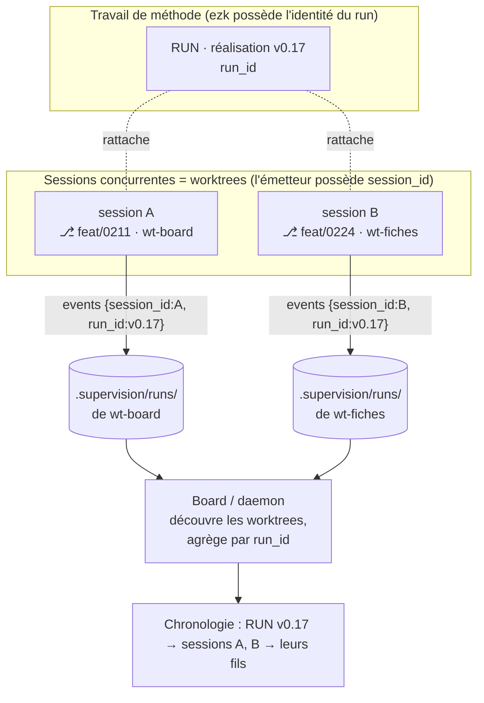

# ADR-075 — Run et session : deux entités distinctes, pour superviser plusieurs LLM concurrents

- **Statut** : Proposé (2026-10-14) — ratification via panel adverse (architecte + devs + juge), sur le modèle d'ADR-0042/0043.
- **Cadre la fiche** : [20261014122044421 — Board : runs et sessions concurrents](../../features/20261014122044421_board-runs-concurrents-identite-lisible.md) (P1, v0.18.0, milestone board) ; conçu par maquette ([docs/maquettes/board-runs-concurrents.html](../maquettes/board-runs-concurrents.html), 8 cas).
- **Amende (de façon bornée)** :
  - [ADR-074](ADR-074-board-unifie-run-moments-fiches-deux-portees-config.md):21 — « un run = une session de la méthode » devient **« un run réunit une ou plusieurs sessions »**. Le reste d'ADR-074 (run → moments → fiches, deux portées de config) est intact.
  - `products/mega-city/docs/adr/0019` (normalisation de la racine vers l'arbre principal) — son **défaut** change **quand la supervision multi-sessions est activée** : on écrit **un journal par worktree** (voir D5). L'échappatoire `SUPERVISION_PER_WORKTREE` devient le mode normal dans ce cas.
- **Respecte sans les rouvrir** :
  - [ADR-035](ADR-035-abandon-siege-run-orphelin.md) — un seul run **écrivain** par journal, `run_finished` exige `run_id`, garde `expected_run_id`. Ces gardes **restent**, appliquées **par journal** (donc par session).
  - `products/mega-city/docs/adr/0042` (concurrence inter-sessions = **visibilité advisory, pas verrou**) et `0043` (vue des sessions servie **live**, jamais committée).
  - [ADR-036](ADR-036-transport-emission-separable-du-runtime.md) (émission = noyau, transports séparables) ; [ADR-028](ADR-028-lecteur-journal-mode-moniteur.md) (projection serveur, front passif) ; [ADR-033](ADR-033-port-metrique-qualite-produit.md) (métriques lues par un port).
- **Déciders** : PO (Thomas). Modèle d'affichage conçu par maquette et tranché par le PO le 2026-10-14. Le modèle de concurrence (D5, choix B) reste à **ratifier en panel**.

## En clair

Aujourd'hui le mot « run » porte deux choses à la fois : le **travail de méthode** (réaliser
une version) et la **session** qui le fait (un LLM, sur un worktree). Dès qu'on lance
plusieurs sessions, ça coince : le board ne sait plus qui fait quoi.

Décision : **séparer les deux**. Un **run** est un travail de méthode. Une **session** est une
période de travail d'un LLM, attachée à un worktree et une branche. Un run **réunit plusieurs
sessions** ; chaque évènement du journal dit **qui** l'a produit (session) et **à quel travail**
il appartient (run). La session n'est pas un concept neuf : elle existe déjà dans le cockpit
`ezk-sessions` (basé sur les worktrees git). On **relie** ce concept au journal, on n'en crée
pas un deuxième.

Rien de tout ça n'est propre à Claude : l'identité vient de **git** (lecture de fichiers), le
contrat reste **MCP + JSONL**. Tout outil LLM qui parle MCP émet pareil.

## Contexte

Six faits cadrent la décision (détaillés dans la fiche).

1. **Le modèle confond run et session** (ADR-074). Un travail de méthode s'étale sur plusieurs
   sessions, ou est mené par plusieurs sessions en parallèle.
2. **Par défaut, un seul journal par dépôt, un seul run ouvert** : deux sessions concurrentes se
   bloquent, ou la seconde devient invisible (`project-root.ts` normalise worktree → arbre
   principal ; `findOpenRun` + l'invariant d'ADR-035).
3. **Une session n'a pas d'identité parlante** dans le journal : seul un `runId` opaque.
4. **La Chronologie du board est un fil unique sans notion de session** : les évènements de
   plusieurs sessions s'entrelacent sans attribution.
5. **La session existe déjà ailleurs** : le cockpit `ezk-sessions` dérive les sessions des
   worktrees git, gère la concurrence par **visibilité advisory** (intersection des fichiers
   touchés), et sert sa vue **live, jamais committée** (ADR-0042/0043). Le journal et le cockpit
   décrivent tous deux « des sessions », mais depuis deux sources qui ne se parlent pas.
6. **Tout doit rester tool-agnostique** : le board résout déjà les modèles par IDE (Claude Code,
   Cursor, Codex CLI, ADR-074) ; le contrat est MCP + JSONL.

## Décision

### D1 — Deux entités distinctes : run et session

- **Run** = une unité de **travail de méthode** (un cadrage, la réalisation d'une version).
  C'est l'objet autour duquel le board s'organise (run → moments → fiches, ADR-074).
- **Session** = une **période de travail d'un émetteur LLM**, attachée à **un worktree** et
  **une branche**, avec un outil donné. C'est la session du cockpit `ezk-sessions` (ADR-0042) —
  **le même objet**, pas un nouveau. Son type (grooming, dev…) reste une **étiquette
  d'affichage** dérivée du préfixe de branche (ADR-0042 D2), jamais l'axe de sécurité.

### D2 — L'évènement du journal est la jointure run ↔ session

Chaque évènement porte **deux** identifiants dans son enveloppe : `session_id` (qui l'a produit)
et `run_id` (à quel travail de méthode il appartient).

- Un run **réunit N sessions** (successives ou concurrentes) : on retrouve ses sessions en
  groupant ses évènements par `session_id`.
- Une session **contribue à un ou plusieurs runs** au fil de sa vie.
- **Pas de clé de durée de vie** entre les deux : la jointure, c'est l'évènement. Le board
  reconstruit l'arbre run → sessions → évènements en lisant le journal.

### D3 — Qui frappe quoi, et l'identité vient de git

- `session_id` : **frappé par l'émetteur** à l'ouverture de la session (comme `run_id`
  aujourd'hui), accompagné d'un **libellé lisible** dérivé de **git en pur file-system** —
  nom de worktree, branche (lecture de `.git/HEAD`, sans lancer `git`, contrainte
  mega-city ADR-0019). Repli : nom de worktree si la branche est détachée.
- `run_id` : reste **frappé par l'émetteur**, mais **la méthode (ezk) décide le rattachement** —
  ouvrir un nouveau run, ou **reprendre** un run existant quand une session poursuit un travail
  déjà commencé. Le mécanisme exact (comment ezk nomme et retrouve « le run réalisation v0.17 »)
  est un détail de build ; l'ADR fige que **l'identité du run appartient à la méthode**, celle
  de la session à l'émetteur.
- **Tool-agnostique, dur** : aucune dépendance à une API propre à Claude Desktop ni à un IDE.
  Le croisement de transcripts Claude Code (`analyze.ts`) reste **hors contrat et hors board**
  (diagnostic local optionnel).

### D4 — La concurrence se gère par la visibilité, pas par un verrou (aligne ADR-0042)

Plusieurs sessions ouvertes **en même temps** sont **normales** et **montrées**. On n'ajoute
**aucun verrou exclusif**. Le garde-fou de collision reste celui d'ADR-0042 (intersection des
fichiers touchés, advisory pour les sessions supervisées, bloquant pour les runs autonomes).

Corollaire : **l'invariant « un seul run ouvert » d'ADR-035 n'est pas une politique de
concurrence** — c'est une **garde d'intégrité d'écriture** d'**un** journal (enveloppe, `seq`,
`event_id` calculés en un seul endroit). On la **préserve**, on ne l'étend pas en interdit
multi-sessions.

### D5 — Un journal par session (= par worktree) — modèle B, **recommandé**

Pour que la garde d'écriture d'ADR-035 tienne **sans aucun nouveau verrou**, chaque session
écrit **son propre journal** : `<worktree>/.supervision/runs/`. Le mode par-worktree
(`SUPERVISION_PER_WORKTREE`, échappatoire de mega-city ADR-0019) **devient le mode normal**
quand la supervision multi-sessions est activée.

- Deux sessions n'écrivent **jamais** dans le même journal ⇒ « un seul run ouvert » tient **par
  journal** (donc par session), **inchangé**. Zéro verrou ajouté.
- Le **board (daemon) découvre les worktrees** (`git worktree list`, exactement comme
  `ezk-sessions` le fait déjà) et **agrège par `run_id`** : un run qui s'étale sur deux
  worktrees voit ses évènements réunis à la lecture.
- La **détection d'orphelin** (`presumed_dead`, ADR-028) et l'**abandon siège** (ADR-035)
  restent **par session/run**, inchangés.

C'est le choix le plus conservateur : il ne touche **pas** à l'invariant d'intégrité, et il
**aligne** session = worktree, déjà le modèle d'`ezk-sessions`. Son coût est la **découverte
multi-racines** par le daemon (déjà outillée côté `ezk-sessions`).

Le **choix B vs C** (ci-dessous) est le point que le **panel** doit ratifier.

### D6 — Contrat additif : `cop1/supervisability@0.2`

Deux ajouts à l'enveloppe/aux types, **rétro-compatibles** : le champ d'enveloppe `session_id`,
et deux types d'évènement `session.started` / `session.finished` (identité lisible dans le
payload du premier). Un lecteur de `@0.1` **tolère** ces évènements et ce champ (il les ignore).
Comme l'ajout touche l'**enveloppe** et non un simple champ de payload (contrairement à
`abandoned_by`, ADR-035), on **bump** l'URI en `@0.2`. La doctrine « la norme, c'est le format »
d'ADR-036 tient : un seul endroit calcule l'enveloppe.

### D7 — La représentation sur le board (tranchée par maquette, PO 2026-10-14)

Servie **live** depuis le journal, **jamais committée** (aligne ADR-0043/0055 : les vues
dérivées des fiches committées restent séparées).

- **Chronologie** = pistes **D + B combinées**, navigation à **3 niveaux** : les runs (global,
  peu de détail) → un run (ses sessions avec hiérarchie + son fil fusionné, chaque évènement
  étiqueté par sa session) → une session (son propre fil). Le menu de gauche sert à la fois de
  **liste des sessions** et de **filtre**.
- **Vue globale des projets** = **accueil « Tous les projets »** (piste 1) : la liste déroulante
  seule ne montrait pas la flotte. Elle reste un raccourci.
- **Rattachement par défaut** : supervision activée ⇒ une session ouverte **s'y rattache sans
  geste** (opt-out), **débrayable** par la config du projet ou sur demande explicite. On évite
  les sessions « hors méthode » ; celles qui le sont restent **visibles comme telles**.

### D8 — Hiérarchie des sessions

Une session peut en **piloter** d'autres (un orchestrateur lance des filles). La relation
« piloté par » est portée par un champ optionnel de `session.started` et **affichée** en arbre
(cas 7 de la maquette). Elle alimente le menu de gauche de la Chronologie (D7).

> **Figure — Un run, deux sessions, deux journaux (modèle B).** La méthode possède l'identité du
> run ; l'émetteur, celle de la session. Chaque évènement porte les deux. Le board découvre les
> worktrees et réassemble par `run_id`. Aucun journal n'est partagé entre sessions, donc la garde
> d'écriture d'ADR-035 tient par journal, sans nouveau verrou.

## Options considérées

| # | Option | Verdict |
|---|---|---|
| **B** | **Un journal par session (par worktree), agrégé par le board** | ✅ **Recommandé**. Ne touche pas à l'invariant d'intégrité d'ADR-035 ; aligne session = worktree (ezk-sessions) ; découverte multi-racines déjà outillée. Coût : le daemon surveille plusieurs racines. |
| **C** | **Racine partagée, N runs ouverts concurrents indexés par id** | 🔁 **À départager en panel**. Garde **une seule racine** (le Moniteur voit tout sans découverte), et c'est *faisable* car les verrous d'écriture sont **déjà par dossier de run** et `run_finished` exige déjà `run_id`. Mais il faut **relâcher** l'invariant « un seul run ouvert » d'ADR-035 (réécrire `findOpenRun` en « liste des runs ouverts », orphelin par run) — on touche une garde durement acquise. Reporté derrière B tant que le besoin « deux sessions dans le même worktree » n'est pas prouvé. |
| A | **Pilote unique : un seul run supervisé par dépôt** | ❌ Aucune visibilité du parallélisme — contredit le besoin de la fiche. |
| — | **Verrou exclusif inter-sessions** | ❌ Déjà écarté par ADR-0042 (visibilité, pas verrou). |
| — | **Inventer un concept « session » parallèle à `ezk-sessions`** | ❌ Deux modèles de session divergeraient. On unifie sur l'existant (worktree). |

## Conséquences

- ✅ **Le board peut dire vrai en multi-sessions** : combien de sessions, que fait chacune, sur
  quel run — en activité comme en chronologie.
- ✅ **Zéro nouveau mécanisme de concurrence** : on réutilise git (worktrees), la garde
  d'écriture d'ADR-035 et le détecteur de collision d'ADR-0042.
- ✅ **Tool-agnostique** : identité par git, contrat MCP + JSONL ; marche pour tout LLM.
- ✅ **Un seul concept de session** : le journal et `ezk-sessions` convergent sur le worktree.
- ⚠️ **Le daemon surveille plusieurs racines** (découverte des worktrees) — nouveau travail de
  projection, borné (même machinerie qu'`ezk-sessions`).
- ⚠️ **Contrat `@0.2`** : additif et rétro-compatible, mais c'est un bump d'enveloppe ; les
  lecteurs et fixtures doivent l'accepter.
- ⚠️ **Le défaut de normalisation de racine change** en multi-sessions (mega-city ADR-0019
  amendé) : à documenter pour ne pas surprendre une session mono-worktree.
- 🔁 **Différé (YAGNI)** : le modèle C (racine partagée, N runs ouverts) ; deux sessions dans un
  même worktree ; tout TTL d'auto-abandon (ADR-035 D7 tient).

## Découpage de build (sans chapeau, ADR-029 : la fiche est le document)

Fiches sœurs à créer après ratification, liées par `milestone: board` + une version, référençant
cet ADR (pas de fiche chapeau) :

1. **Émetteur (mega-city)** — `session_id` + `session.started/finished`, identité git pur FS,
   mode par-worktree normal, contrat `@0.2`.
2. **Board — modèle de lecture (cop1)** — agrégation multi-racines par `run_id`, read-model
   run → sessions → évènements.
3. **Board — Chronologie D+B** (3 niveaux) et **accueil « Tous les projets »**.
4. **Rattachement par défaut** (opt-out débrayable) côté méthode.
