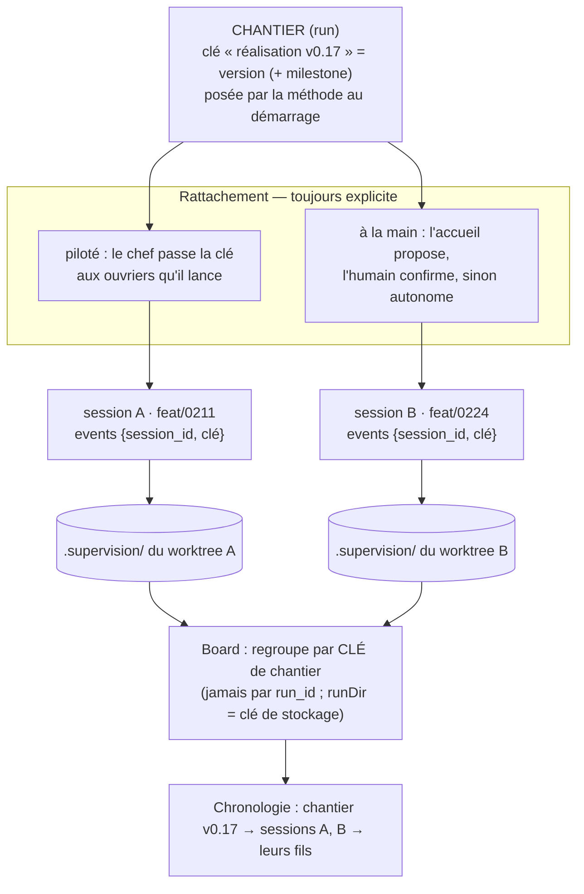

# ADR-075 — Run et session : deux entités distinctes, pour superviser plusieurs LLM concurrents

- **Statut** : Accepté (2026-10-15). Ratifié par **panel adverse** le 2026-10-14 (architecte + dev émetteur + dev board + juge → GO-avec-changements, **modèle B**) ; corrections du panel intégrées ; **attribution du chantier tranchée avec le PO** le 2026-10-15.
- **Cadre la fiche** : [20261014122044421 — Board : runs et sessions concurrents](../../features/20261014122044421_board-runs-concurrents-identite-lisible.md) (P1, v0.23.0, milestone board) ; conçu par maquette ([board-runs-concurrents.html](../maquettes/board-runs-concurrents.html), 8 cas).
- **Amende de façon bornée** :
  - [ADR-074](ADR-074-board-unifie-run-moments-fiches-deux-portees-config.md):21 — « un run = une session » devient **« un run (chantier) réunit une ou plusieurs sessions »**.
  - `products/mega-city/docs/adr/0019` (normalisation racine → arbre principal) — le défaut devient **un journal par worktree** quand la supervision multi-sessions est activée (D5).
  - [ADR-028](ADR-028-lecteur-journal-mode-moniteur.md) — « un snapshot par `runId` » et le **hot-reload différé des watch-roots** sont rouverts : N journaux par chantier, racines dynamiques (D8, D9).
  - La **lecture niveau-run** d'[ADR-035](ADR-035-abandon-siege-run-orphelin.md) — le cycle de vie d'un chantier réparti sur N journaux est nouveau (D8). *(La garde d'**écriture** d'ADR-035, elle, est respectée — voir ci-dessous.)*
- **Respecte sans les rouvrir** :
  - [ADR-035](ADR-035-abandon-siege-run-orphelin.md) **écriture** : un seul écrivain par journal, `run_finished` exige `run_id`, garde `expected_run_id` — tiennent **par journal** (donc par session), inchangés.
  - [ADR-036](ADR-036-transport-emission-separable-du-runtime.md) y compris **#4** (interdit de rattacher l'émission à un run existant) : `run_id` reste **frappé par l'émetteur**, on ne « reprend » jamais un run_id ; le rattachement passe par une **clé de chantier en payload** (D2), pas par le run_id.
  - `products/mega-city/docs/adr/0042` (concurrence = **visibilité, pas verrou**), `0043`/`0055` (vues **live, jamais committées**), `0021` (cop1 **n'importe pas** mega-city → la découverte des worktrees est du code **neuf, cop1-local**, D9).

## En clair

Un **run** est un **chantier** : un travail de méthode avec un début et une fin (« réaliser la v0.17 »). Une **session** est un **ouvrier** : un LLM qui travaille un moment, dans son worktree. Un chantier **réunit plusieurs ouvriers** ; chaque note qu'un ouvrier écrit dit **qui** l'a écrite et **pour quel chantier**.

Deux ouvriers sont sur le même chantier **seulement quand on l'a dit explicitement** — jamais deviné. Deux voies : **piloté** (un chef lance les ouvriers et leur passe le chantier) ou **à la main** (une étape d'accueil propose, l'humain confirme, sinon la session est autonome). Chaque ouvrier a **son carnet** (un journal par worktree, « modèle B ») ; le tableau ramasse les carnets et les **regroupe par chantier**.

Rien n'est propre à Claude : l'identité vient de **git**, le contrat est **MCP + JSONL**.

## Contexte

Six faits cadrent la décision (détail dans la fiche).

1. Le modèle confond run et session (ADR-074) — or un chantier s'étale sur plusieurs ouvriers, en parallèle ou dans le temps.
2. Par défaut un seul journal par dépôt et un seul run ouvert → deux sessions concurrentes se bloquent ou l'une devient invisible.
3. Une session n'a pas d'identité parlante dans le journal (un `runId` opaque).
4. La Chronologie du board est un fil unique **sans notion de session** → les évènements s'entrelacent sans attribution.
5. **La session existe déjà** : le cockpit `ezk-sessions` la dérive des worktrees, gère la concurrence par visibilité advisory, sert sa vue live/jamais committée (ADR-0042/0043). On **relie** ce concept au journal.
6. Tout doit rester **tool-agnostique** (le board résout déjà les modèles par IDE ; contrat MCP + JSONL).

## Décision

### D1 — Deux entités : chantier (run) et ouvrier (session)

- **Run = chantier** : une unité de travail de méthode (cadrer un lot, réaliser une version), faite d'étapes (moments) touchant des fiches (ADR-074).
- **Session = ouvrier** : une période de travail d'un émetteur LLM, attachée à **un worktree** et **une branche**. C'est la session d'`ezk-sessions` — **le même objet**, pas un nouveau. Son type (grooming, dev…) reste une étiquette d'affichage dérivée du préfixe de branche (ADR-0042).

### D2 — La jointure, et la clé d'agrégation (tranché, panel)

Chaque évènement porte, dans son enveloppe, **`session_id`** (qui) et une **clé de chantier** (pour quel travail). Règles, **vérifiées contre le code** :

- `run_id` reste **frappé par l'émetteur**, horodaté, **unique par session** (`generateRunId`, `runtime.ts:100-103`). Cela préserve le tri de `findOpenRun`, l'invariant « un seul run ouvert par journal » et l'interdit ADR-036 #4. **On n'agrège JAMAIS par `run_id`.**
- La **clé de chantier** (« réalisation v0.17 ») voyage dans le **payload de `run.started`**. Elle est **construite depuis la `version` (+ `milestone`)** — pas un champ qu'un humain remplit sur une fiche.
- Le board **regroupe par cette clé, qualifiée par la racine de projet**. La **clé de stockage reste `runDir`** : la conception anti-collision de `SupervisionService.ts:29-33` (« le runId n'est qu'un champ d'affichage, jamais une clé ») est **préservée intacte**. La clé de chantier est traitée en donnée semi-hostile (forme validée, scopée par racine).

### D3 — Comment une session reçoit sa clé de chantier (tranché, PO)

**Le lien est toujours explicite — jamais deviné par co-présence dans un projet.** Deux voies :

- **Piloté** : une session **pilote** (orchestrateur) ouvre le chantier et **passe la clé** aux sessions ouvrières qu'elle lance. C'est le cas « plusieurs features indépendantes d'une version », et c'est déjà l'esprit d'`ezk-product-build`.
- **À la main** : une **étape d'accueil** à l'ouverture de session (crochet `CLAUDE.md` + skill d'ouverture) lit les **chantiers ouverts** + la **version/le sprint en cours**, puis **propose** : rattacher, ou autonome. L'humain confirme ; une **règle de config** peut auto-confirmer les cas clairs (ex. branche du sprint en cours) ; sinon la session est **autonome** (son propre chantier) ou **hors méthode** (visible comme telle, cas 7B).

Garde-fous de l'accueil : **advisory, pas un verrou** (ADR-0042) ; **ne bloque jamais** le travail ; **dégrade en autonome** s'il ne sait pas trancher ; **configurable par projet** (débrayable). En run **autonome** sans humain : clé passée par le pilote (explicite) ou autonome par défaut — aucune question.

### D4 — Concurrence par visibilité, pas verrou

Plusieurs sessions ouvertes en même temps sont normales et montrées. **Aucun verrou exclusif** (ADR-0042). L'invariant « un seul run ouvert » d'ADR-035 est une **garde d'intégrité d'écriture** d'**un** journal, pas une politique de concurrence : on le **préserve**, on ne l'étend pas en interdit multi-sessions.

### D5 — Un journal par session (= par worktree) : modèle B (ratifié)

Chaque session écrit **son propre journal** (`<worktree>/.supervision/runs/`) : la garde d'écriture d'ADR-035 tient **par journal**, **zéro nouveau verrou**. Le mode par-worktree devient le mode normal en multi-session (amende le défaut de mega-city 0019).

- **B vs C — pourquoi B.** C garderait une seule racine mais obligerait à réécrire `findOpenRun` en « liste des runs ouverts » + orphelin par run : on toucherait la garde d'écriture durcie sur un bug P0 (fiche 0168). Un bug en **lecture** (B) dégrade une vue ; un bug en **écriture** (C) corrompt des journaux. **B paie en travail de lecture ce que C paierait en risque sur l'intégrité.**
- **Limite de B, assumée** : session = worktree est **rigide**. Deux LLM dans le **même** checkout → le second est bloqué (comme aujourd'hui). YAGNI, aucun besoin prouvé ; énoncé comme frontière, pas tu.
- **`.supervision/` gitignoré sur TOUTES les branches** (+ un garde type `untracked-views`), sinon un worktree sur une vieille branche tracke son journal → churn (rouvre 0043/0055).

### D6 — Substrat et cycle de vie d'une session (panel, émetteur)

Le runtime est **sans mémoire** et le journal est **par-run** : il n'y a pas de domicile naturel pour une session qui couvre plusieurs runs. Donc :

- `session_id` vit dans l'**enveloppe** des évènements run-scopés, **frappé par l'émetteur** (comme `run_id`) ; un petit fichier par worktree (`<worktree>/.supervision/session.json`) le fige une fois.
- `run.started` **reste la première ligne** de chaque journal de run (le validateur l'exige, `reduceState.ts`) : `session.*` ne sont pas des évènements de tête.
- `session.started` / `session.finished` sont **best-effort** : le process MCP est tué par l'hôte, sans hook fiable → **le board infère la fin** (silence prolongé / dernier run clos).
- Les `session.*` sont émis **hors fenêtre de jalon ouvert** (sinon violation `state.activity_while_gate_open`).

### D7 — Contrat `cop1/supervisability@0.2`

Ajouts **additifs** : champ d'enveloppe `session_id`, clé de chantier en payload de `run.started`, types `session.started`/`session.finished`. Le bump est une **honnêteté de format** (l'enveloppe change, ADR-036), pas une nécessité d'interop. **Le lecteur `@0.2` doit enregistrer** `session_id` et les types `session.*` (`KNOWN_ENVELOPE_FIELDS`, `KNOWN_EVENT_TYPES`) : sinon un lecteur `@0.1` **ne les ignore pas** — il émet une notice par ligne, et un `session.*` pendant un jalon ouvert devient une violation. Fixtures `@0.1` à mettre à jour.

### D8 — Read-model étendu = travail neuf (panel, board)

Aujourd'hui `projectRun` lit **un** journal et rend des **agrégats** (pas de liste d'évènements, aucune notion de session). À construire :

- un projecteur exposant la **liste d'évènements étiquetés `session_id`** ;
- un **index « clé de chantier → sessions → évènements »** (+ le champ `piloted_by` pour l'arbre de hiérarchie, cas 7) ;
- une **règle d'ordonnancement inter-journaux tolérante** : pas le `ts` brut (semi-hostile, déjà écarté au profit de `lastAbsorbedAt`) — `ts` + départage stable par `session_id`/`seq`, dérive bornée ;
- le **cycle de vie d'un chantier réparti sur N journaux** (en cours / au jalon / fini / orphelin) et la **sémantique badges/compteurs** (par-session vs par-chantier), sans double compte.

### D9 — Découverte des worktrees = code neuf, cop1-local (panel, ADR-021)

Le watcher prend des `watchRoots` **statiques**, lus une fois (`JournalWatcherAdapter.ts:97-113`). D5 exige :

- un **énumérateur de worktrees propre à cop1** (pas d'import mega-city, ADR-021 — recopie légère comme le lecteur `registry.ts`) ;
- une **gestion dynamique des watch-roots** (ajout/retrait à chaud) — rouvre le hot-reload différé d'ADR-028 — avec l'impact sur le cap `MAX_WATCHED_RUN_DIRS=512` (projets × worktrees × runs) ;
- noter la re-projection **fichier entier** (ADR-028) sur de longs journaux multi-sessions : le replay incrémental différé est rouvert (borné).

### D10 — Identité par git, pur FS, chemin correct ; tool-agnostique

Dans un worktree lié, `.git` est un **fichier** `gitdir:` → la branche se lit dans `<gitdir>/HEAD` (symref `ref: refs/heads/<branche>`), pas `<root>/.git/HEAD`. On **réutilise la résolution de `project-root.ts`** (gitdir/commondir, déjà en pur FS, sans `git`). Repli HEAD détachée → nom de worktree. Aucune dépendance à une API Claude ; le croisement de transcripts Claude Code (`analyze.ts`) reste **hors contrat et hors board**.

### D11 — Représentation board (PO, sur maquette — hors débat panel)

Servie **live** depuis les journaux, **jamais committée** (ADR-0043/0055). Chronologie **D+B à 3 niveaux** (les chantiers → un chantier avec ses sessions + son fil fusionné → une session) ; **accueil « Tous les projets »** ; rattachement par l'accueil (D3).

> **Figure.** La méthode pose la clé du chantier (depuis version+milestone). Deux voies explicites l'amènent à une session : le chef (piloté) ou l'accueil (manuel). Chaque session écrit son propre journal (B). Le board regroupe par la clé, jamais par le `run_id` (qui reste un identifiant d'affichage, per-session) ; `runDir` reste la clé de stockage anti-collision.

## Options considérées

| # | Option | Verdict |
|---|---|---|
| **B** | Un journal par session (par worktree), regroupé par clé de chantier | ✅ **Ratifié** (panel). Préserve la garde d'écriture d'ADR-035 ; aligne session = worktree. Coût : découverte multi-racines + read-model neuf (D8/D9). |
| C | Racine partagée, N runs ouverts indexés par id | ❌ Rouvre l'invariant d'écriture d'ADR-035 (risque sur une garde P0) ; le casse-tête read-model est **identique** à B ⇒ C n'achète rien en lecture et coûte en risque. |
| — | `run_id` déterministe (dérivé de version+milestone) comme clé d'agrégation | ❌ Casse le tri chrono de `findOpenRun` et est collision-prone ; la clé logique va en **payload**, pas dans le run_id. |
| — | Agréger par `run_id` | ❌ Contredit l'anti-collision de `SupervisionService` (run_id = affichage, jamais une clé). |
| A | Pilote unique obligatoire | ❌ Interdirait les sessions manuelles autonomes (grooming, correctif hors cadre) — besoin réel du PO. |
| — | Relier deux sessions par co-présence dans le projet (deviner) | ❌ Faux et risqué ; le lien est explicite (D3). |

## Conséquences

- ✅ Le board dit vrai en multi-sessions (activité **et** chronologie), sans que le PO coordonne à la main : le lien est posé par le pilote ou proposé par l'accueil.
- ✅ Zéro nouveau mécanisme de concurrence ni de verrou ; la garde d'écriture d'ADR-035 reste intacte.
- ✅ Un seul concept de session (worktree), unifié avec `ezk-sessions` ; tool-agnostique.
- ⚠️ **Travail neuf non trivial** : read-model étendu (D8) et découverte dynamique des worktrees (D9) — c'est le vrai coût, à ne pas sous-estimer.
- ⚠️ Contrat `@0.2` (lecteur + fixtures) ; `.supervision/` gitignoré partout + garde.
- ⚠️ `session = worktree` rigide (D5) ; défaut de normalisation de racine changé en multi-session.
- 🔁 Différé : modèle C ; deux sessions dans un même worktree ; tout TTL d'auto-abandon.

## Découpage de build (sans chapeau, ADR-029)

Fiches sœurs, liées par `milestone: board` + une version, référençant cet ADR :

1. **Émetteur (mega-city)** — `session_id` (enveloppe) + `session.json` par worktree + `session.started/finished` best-effort ; clé de chantier en payload de `run.started` (depuis version+milestone) ; mode par-worktree par défaut ; branche via `<gitdir>/HEAD` ; contrat `@0.2` + lecteur + fixtures ; `.supervision/` gitignoré partout + garde.
2. **Board — read-model (cop1)** — projecteur à liste d'évènements étiquetés session + index clé→sessions→events + ordonnancement inter-journaux tolérant + cycle de vie du chantier multi-journaux ; regroupement par clé (runDir reste clé de stockage).
3. **Board — découverte & watch dynamique (cop1)** — énumérateur de worktrees cop1-local + watch-roots dynamiques + cap 512 revu.
4. **Board — Chronologie D+B (3 niveaux) + accueil « Tous les projets »** (servis live).
5. **Rattachement — étape d'accueil (méthode)** — crochet `CLAUDE.md` + skill d'ouverture : propose rattachement/autonome, débrayable par config, advisory, dégrade en autonome.
