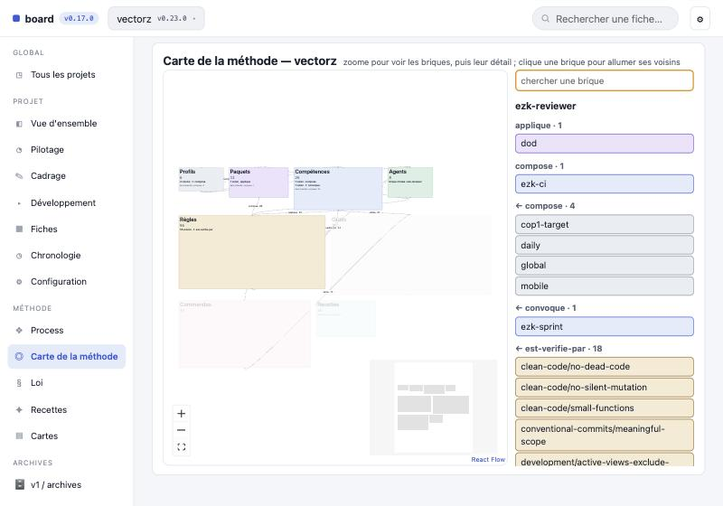
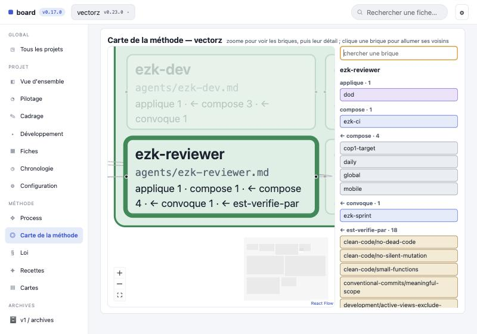
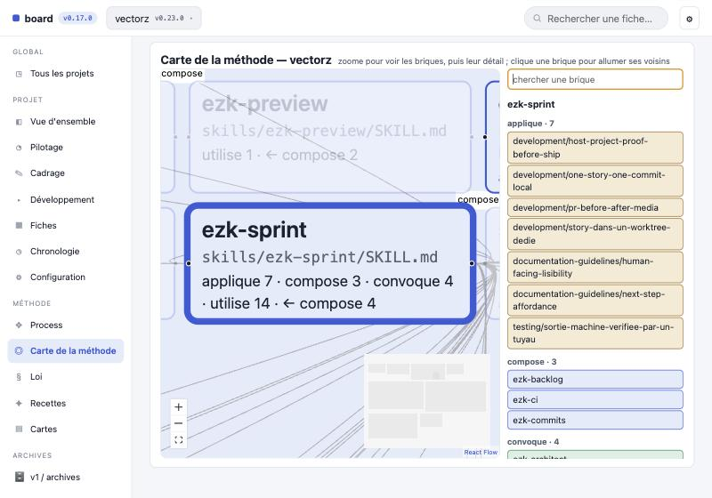

# 20261117154145517 — La carte de la méthode se déplace sur la brique choisie par la recherche

**En clair.** Depuis le sprint 11, on choisit une brique en tapant son nom. Le panneau liste alors ses
voisins, mais la carte ne bouge pas. Vue de loin, la brique reste invisible. On fait venir la carte sur
la brique choisie, comme un double-clic.

**Si tu arrives frais.** La carte de la méthode (`GraphMap.tsx`) a trois niveaux. De loin (niveau 1),
elle montre les familles. Les briques n'apparaissent qu'en zoomant (niveau 2). Le champ de recherche
vit dans le panneau des voisins, à droite.

## Contexte / Problème

La fiche
[On cherche une brique par son nom sur la carte de la méthode](done/20261117153250174_carte-methode-chercher-une-brique.md)
a laissé ce point hors de son périmètre.

## Proposition

Quand la recherche choisit une brique, la carte se cadre dessus, en deux temps si besoin.

1. Vue de loin, la carte cadre d'abord la famille de la brique, assez près pour passer au niveau 2.
2. Dès que les briques sont dessinées, la carte cadre la brique elle-même.

Un clic sur la carte ne déplace rien : seul le choix par la recherche cadre.

## Critères d'acceptation

- [x] Choisie depuis la vue de loin, la brique finit au centre de la carte, au niveau des briques.
- [x] Déjà au niveau des briques, la carte cadre directement la brique.
- [x] La règle des deux temps est une fonction pure, testée : brique dessinée → la brique ; sinon sa famille, avec un zoom minimal au-dessus du seuil du niveau 2.

## Comment vérifier

```bash
cd products/cop1/packages/web && pnpm exec vitest run src/board/graphProjection.test.ts src/board/GraphMap.test.tsx
```

Dans mission control : page Carte de la méthode, vue de loin, taper `reviewer` puis Entrée. La carte
vient sur `ezk-reviewer`.

## Notes / décisions

- Créée et tirée au sprint 12 du 17 novembre, par délégation du PO absent. Le cadrage de la caméra ne
  se mesure pas dans jsdom : la preuve d'écran vient du navigateur.

**Avant / après** (règle `development/pr-before-after-media`), captures du 2026-11-17 sur les vraies données de vectorz :

| Moment | Avant (main) | Après (branche) |
|---|---|---|
| Vue de loin, `reviewer` puis Entrée |  |  |
| Déjà de près, `ezk-sprint` puis Entrée | — |  |

**Livraison du 2026-11-17.** Revue adverse `ezk-reviewer` : GO. Les critères 2 et 3 sont prouvés par
les tests de `focusStep`. Le critère 1 est prouvé par les captures ci-dessus, prises dans le navigateur.
Les deux réserves P3 sont corrigées. Un clic dans le vide annule aussi un cadrage en cours.
