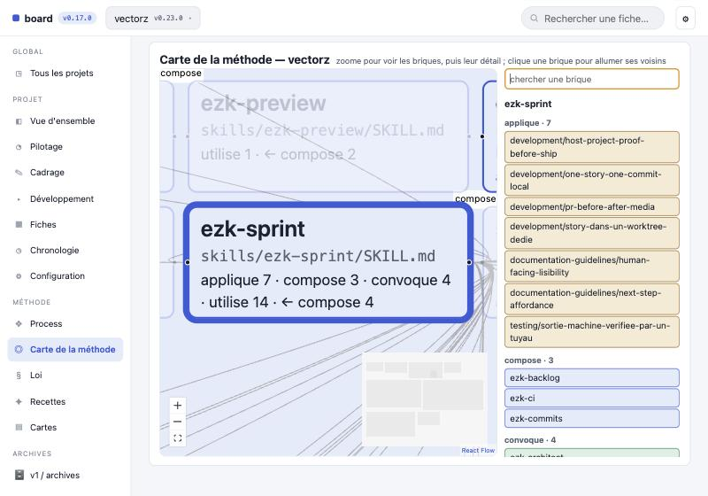
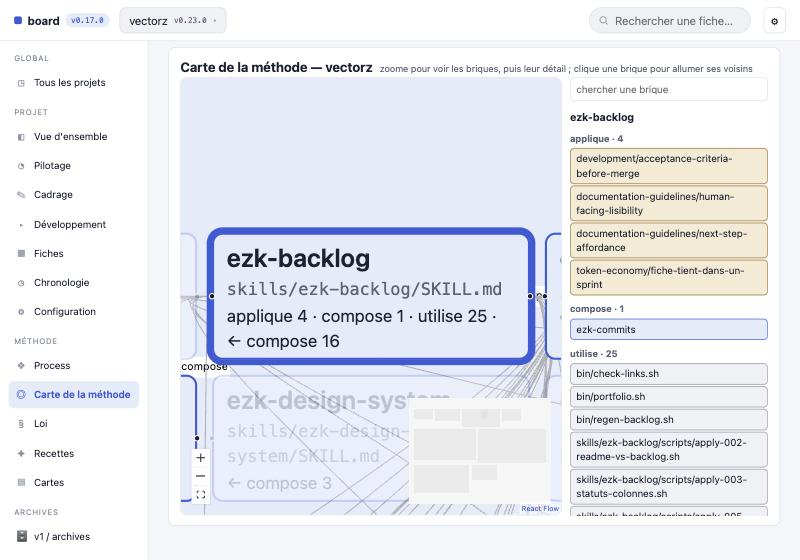

# 20261117154848444 — Un clic sur un voisin du panneau déplace aussi la carte de la méthode

**En clair.** Depuis le sprint 12, choisir une brique par la recherche fait venir la carte sur elle. Un
clic sur un voisin dans le panneau choisit aussi une brique, mais la carte ne bouge pas : le voisin peut
rester hors de l'écran. On donne le même comportement aux deux gestes.

**Si tu arrives frais.** La carte de la méthode (`GraphMap.tsx`) a un panneau à droite qui liste les
voisins de la brique choisie. Chaque voisin est un bouton. La recherche du même panneau sait déjà cadrer
une brique.

## Contexte / Problème

Suite de la fiche
[La carte de la méthode se déplace sur la brique choisie par la recherche](done/20261117154145517_carte-methode-cadre-la-brique-cherchee.md).
En parcourant les voisins de proche en proche, on perd la brique choisie de vue.

## Proposition

Un clic sur un voisin du panneau passe par le même chemin que la recherche : il choisit la brique et
cadre la carte dessus. Un clic sur la carte elle-même ne cadre toujours rien.

## Critères d'acceptation

- [x] Un clic sur un voisin du panneau le choisit, et la carte vient sur lui.
- [x] Le panneau n'a plus qu'un seul chemin pour choisir une brique : la recherche et les voisins
      appellent la même fonction.

## Comment vérifier

```bash
cd products/cop1/packages/web && pnpm exec vitest run src/board/GraphMap.focus.test.tsx src/board/GraphMap.test.tsx
```

Dans mission control : choisir `ezk-sprint`, puis cliquer `ezk-backlog` dans le panneau. La carte vient
sur `ezk-backlog`.

## Notes / décisions

- Créée et tirée au sprint 13 du 17 novembre, par délégation du PO absent.

**Avant / après** (règle `development/pr-before-after-media`), captures du 2026-11-17 sur les vraies données de vectorz :

| Avant le clic : `ezk-sprint` choisi, `ezk-backlog` dans le panneau | Après le clic sur `ezk-backlog` : la carte vient sur lui |
|---|---|
|  |  |

Avant ce changement, le clic choisissait `ezk-backlog` sans bouger la carte. Le test
`GraphMap.focus.test.tsx` l'a montré rouge avant le correctif : aucun cadrage demandé.

**Livraison du 2026-11-17.** Revue adverse `ezk-reviewer` : GO, 2 critères prouvés par
`GraphMap.focus.test.tsx`. Sa réserve P3 est corrigée : la commande de « Comment vérifier » lance
maintenant ce fichier.
