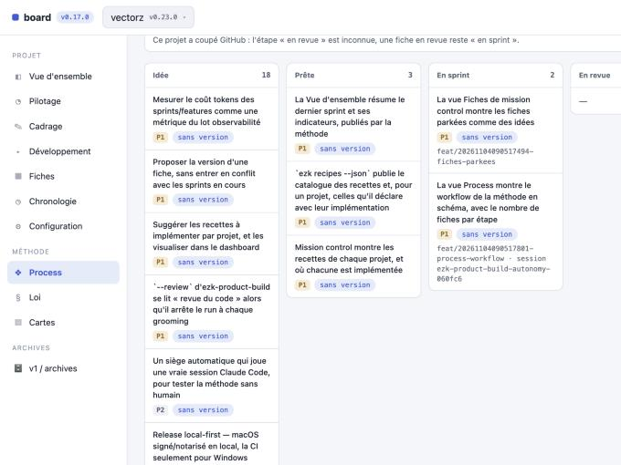

# 20261104090517801 — La vue Process montre le workflow en schéma

**En clair.** La vue Process range les fiches en colonnes, mais rien ne montre le chemin qu'elles
suivent. Un lecteur neuf ne voit ni l'ordre des étapes ni ce qui se passe dans un sprint. On ajoute
en tête de la vue un schéma de flux, comme dans un outil pro : les étapes reliées par des flèches,
le nombre de fiches sur chacune, et les étapes internes d'un sprint.

**Si tu arrives frais.** Le workflow de la méthode : une idée est groomée, passe « prête », entre
en sprint (tests d'acceptation, code, gate, revue, merge), puis est livrée. Une fiche peut aussi
être parkée, mise de côté hors du flux.

## Contexte / Problème

Le PO demande le 2026-11-04 un « workflow bien montré et visualisable comme dans un produit pro ».
Aujourd'hui, la vue Process est un kanban de cinq colonnes. Elle dit où sont les fiches, pas comment
elles avancent. Les étapes d'un sprint n'apparaissent nulle part dans mission control.

## Proposition

Un bandeau « Workflow » en tête de la vue Process :

```
 Idée ──▶ Prête ──▶ En sprint ──▶ En revue ──▶ Livrée
  18        0          0             0           369
                  BDD · TDD · gate · revue · merge
 Parkées : 85 (hors flux)
```

- Une pastille par étape publiée par la méthode, avec son nombre de fiches, reliées par des flèches.
- Sous « En sprint », la suite des étapes internes du sprint, en petit.
- Les parkées à part, avec leur nombre, hors des flèches.
- Une pastille cliquable fait défiler jusqu'à sa colonne du kanban.
- Rien n'est inventé côté page : les étapes et les nombres viennent de `ezk board process --json`,
  les parkées du compte déjà publié.

Une surface : l'écran.

## Critères d'acceptation

- [x] La vue Process montre en tête un schéma : une pastille par étape publiée, dans l'ordre, reliées
      par des flèches, chacune avec son nombre de fiches.
- [x] Les nombres du schéma égalent ceux des colonnes du kanban.
- [x] Les étapes internes d'un sprint s'affichent sous l'étape « En sprint ».
- [x] Les fiches parkées apparaissent à part, avec leur nombre, hors du flux.
- [x] Cliquer une pastille amène à sa colonne.
- [x] Le schéma reste lisible en largeur réduite : il passe à la ligne au lieu de déborder.
      (Prouvé par la règle CSS `flex-wrap` et l'œil ; aucun test automatisé ne mesure la mise en page.)

## Comment vérifier

```bash
pnpm --dir products/cop1/packages/web exec vitest run src/board/ProcessView.test.tsx
```

Puis ouvrir mission control, vue Process : le schéma est en tête, ses nombres égalent les colonnes.

Avant / après, vue Process de vectorz (2026-11-04) :

- avant : cinq colonnes, sans chemin ni étapes de sprint — 
- après : le schéma Idée 18 → Prête 3 → En sprint 2 → En revue 0 → Livrée 369, les étapes du sprint, les parkées hors flux — 

## Notes / décisions

- Lot « mission control lisible » du run du 2026-11-04.
- Les étapes internes du sprint sont un libellé fixe de la page, tiré de la skill `ezk-sprint`
  (BDD, TDD, gate, revue, merge) ; elles ne portent pas de compte, la méthode ne publie pas encore
  l'étape d'une fiche dans un sprint.
- Preuve avant/après : capture de la vue Process.
