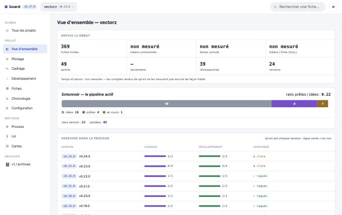
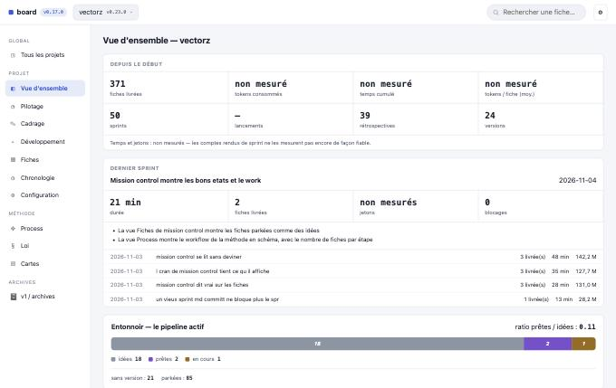

# 20261104090517904 — La Vue d'ensemble résume le dernier sprint et ses indicateurs

**En clair.** Chaque sprint laisse un compte rendu daté : sa durée, ses jetons, ses fiches livrées,
ses blocages. Mission control n'en montre rien : la Vue d'ensemble compte « 49 sprints » et affiche
« non mesuré » partout. La méthode publiera les derniers comptes rendus, et la Vue d'ensemble
montrera une carte « Dernier sprint » avec ses chiffres.

**Si tu arrives frais.** Un compte rendu de sprint est un fichier `docs/sprints/<date>-sprint-<slug>.md`
écrit à la clôture du sprint, avec un bloc « Détail » chiffré.

## Contexte / Problème

Le PO demande le 2026-11-04 « résumé du sprint + KPI » dans mission control. Aujourd'hui :

- `ezk board show --json` publie `historique: { sprints, retros }`, deux nombres seulement.
- La Vue d'ensemble affiche « non mesuré » pour les jetons et le temps.
- Les comptes rendus, eux, mesurent : le sprint du 2026-11-03 « mission-control-se-lit-sans-deviner »
  a duré 48 min et livré 3 fiches.

## Proposition

1. **La méthode publie** dans `ezk board show --json` un champ `derniersSprints` : les 5 comptes
   rendus les plus récents, chacun avec son slug, sa date de fin, sa durée, ses jetons, ses fiches
   livrées et son nombre de blocages. Un compte rendu non daté ou illisible publie ce qu'il a, et le
   dit, sans faux zéro.
2. **Le daemon** passe ce champ tel quel à la page.
3. **La Vue d'ensemble** montre une carte « Dernier sprint » : objectif, date, durée, fiches livrées
   par leur titre, jetons, blocages. En dessous, les 4 sprints précédents en une ligne chacun.

Trois surfaces : la commande, le serveur, l'écran. La fiche reste entière : le serveur ne fait que
passer le champ, sans logique, et découper laisserait un contrat publié sans lecteur.

## Critères d'acceptation

- [x] `ezk board show --json` publie `derniersSprints` : au plus 5 comptes rendus, du plus récent au
      plus ancien, avec slug, fin, durée, jetons, fiches livrées et blocages ; le contrat versionné et
      son schéma le décrivent.
- [x] Une valeur absente d'un compte rendu est publiée comme absente, jamais comme zéro.
- [x] La Vue d'ensemble montre la carte « Dernier sprint » avec ces chiffres et les titres des fiches
      livrées.
- [x] Les 4 sprints précédents s'affichent en une ligne chacun sous la carte.
- [x] Sans compte rendu publié, la carte dit « aucun sprint publié » au lieu de disparaître.
- [x] Les tests de la méthode, du traducteur et de la vue couvrent ces cas.

## Comment vérifier

```bash
ezk board show --json | jq '.derniersSprints[0]'
pnpm --dir products/mega-city test -- board-contract
pnpm --dir products/cop1/packages/web exec vitest run src/board/OverviewView.test.tsx
```

Puis ouvrir la Vue d'ensemble : la carte « Dernier sprint » montre le sprint le plus récent.

Avant / après, Vue d'ensemble de vectorz (2026-11-04) :

- avant : « 49 sprints » et « non mesuré », rien sur le dernier sprint — 
- après : la carte « Dernier sprint » (21 min, 2 fiches livrées par leur titre, jetons « non mesurés », 0 blocage) et les 4 sprints précédents — 

## Notes / décisions

- Lot « mission control lisible » du run du 2026-11-04.
- Recoupe en partie la fiche [Mesurer le coût tokens des sprints/features](../20261008182705779_adaptateur-cout-tokens-observabilite.md) :
  ici on **affiche** ce que les comptes rendus mesurent déjà, sans changer la mesure.
- Preuve avant/après : capture de la Vue d'ensemble.
