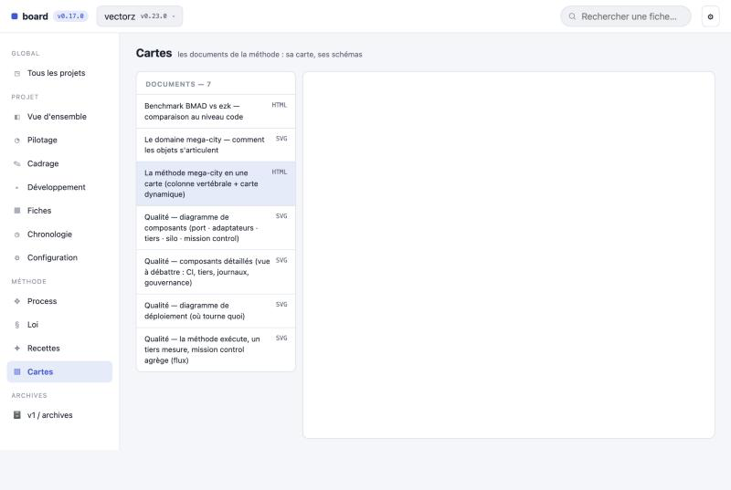
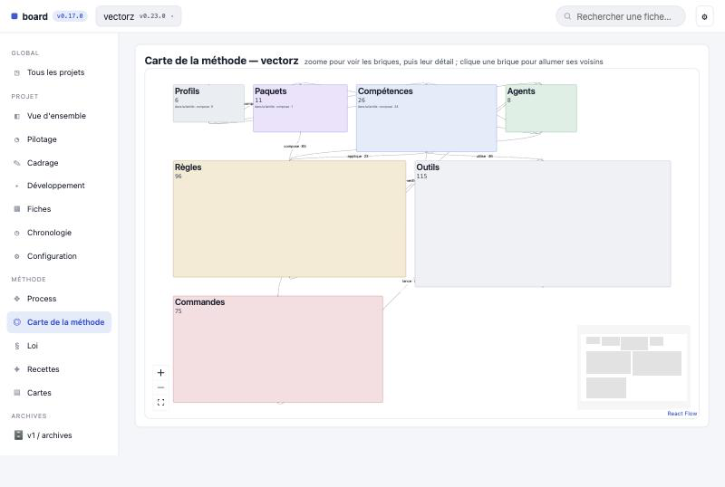
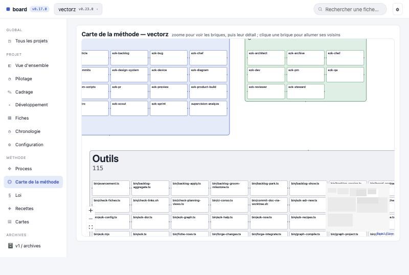
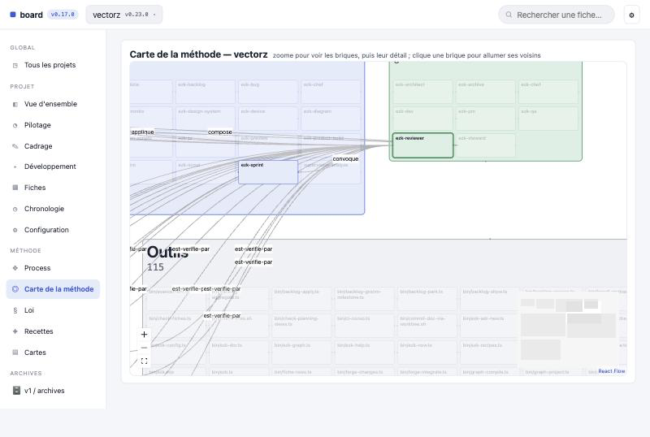

# 20261117114544792 — La carte de la méthode, zoomable

**En clair.** Mission control montre le process de chaque projet sur une carte qu'on zoome. On veut le
même mécanisme pour tout ce qui est relié dans la méthode : compétences, agents, règles, paquets,
profils, outils et commandes. De loin, on voit les familles et leurs liens ; en s'approchant, chaque
brique ; un clic sur une brique allume ses voisins. On voit enfin ce qui dépend de quoi.

**Si tu arrives frais.** Mission control est l'écran de pilotage (produit cop1). Une brique est un
élément de la méthode : une compétence comme `/ezk-sprint`, un agent comme `ezk-reviewer`, une règle,
une commande `ezk`. Le zoom sémantique change le niveau de détail selon le zoom, sans bouton de niveau.

## Contexte / Problème

Le PO, le 2026-11-17 : « je souhaite utiliser le même mécanisme que pour le process avec un outil
zoomable, mais pour montrer tout ce qui est intriqué dans la méthode ezk (commandes, agents, règles…) ».

La carte Process (fiche 20261110185357446, livrée le 17 nov.) montre le chemin d'une fiche. Elle ne
montre pas qui convoque qui, quelle règle s'applique où, quelle commande sert à quoi. La page Cartes
garde une ancienne carte interactive, un document à part, qui ne lit pas les données de la méthode.

## Proposition

Une nouvelle page **Carte de la méthode** dans le groupe Méthode de mission control, sur le modèle de
la carte Process :

1. **Données** : le contrat `graph-check/v1` (fiche
   [La méthode publie son graphe en contrat](20261117114544666_graphe-publie-en-contrat-commandes-comprises.md)),
   servi par le daemon sur `GET /api/graph/<projet>`, sur le modèle de `/api/process/<projet>`.
2. **Projection pure, sans React** : `projectGraphToFlow(contrat, niveau, sélection)` → nœuds et arêtes.
   - Niveau 1 : une boîte par famille, avec son compte ; une arête par paire de familles et par verbe,
     avec son compte (« compétences ─ applique ─► règles · 23 »).
   - Niveau 2 : chaque brique rangée dans la boîte de sa famille. Pas d'arête par défaut : 300 liens à
     la fois seraient illisibles.
   - Niveau 3 : le détail d'une brique : fichier, et ses liens comptés par verbe.
   - Sélection : un clic sur une brique l'allume avec ses voisins, dessine leurs liens, et estompe le reste.
3. **Rendu** : React Flow, même hook zoom → niveau avec hystérésis, positions fixes entre niveaux,
   mini-carte et boutons de zoom. Le mécanisme commun est partagé avec la carte Process, pas recopié.

## Critères d'acceptation

- [x] Le groupe Méthode de mission control a une page « Carte de la méthode » qui lit
      `GET /api/graph/<projet>` ; sans contrat, elle dit pourquoi, et aucune brique n'est écrite en dur.
- [x] De loin, la carte montre les 7 familles avec leur compte et leurs liens comptés par verbe.
- [x] En s'approchant, chaque brique apparaît dans sa famille ; plus près, son détail.
- [x] Un clic sur une brique allume la brique et ses voisins directs, dessine leurs liens et estompe le
      reste ; un second clic, ou un clic dans le vide, rétablit la carte.
- [x] Le niveau suit le zoom avec la même hystérésis que la carte Process, et changer de niveau ne
      déplace pas la caméra.
- [x] La projection est une fonction pure, testée sur un contrat réel.

## Comment vérifier

```bash
cd products/cop1/packages/web && pnpm exec tsc --noEmit && pnpm exec vitest run
pnpm cop1:dev   # puis « Carte de la méthode » dans le groupe Méthode
```

- vue carte-methode : http://localhost:5281/ puis « Carte de la méthode »

**Avant / après** (règle `development/pr-before-after-media`), captures du 2026-11-17 :

| Vue | Avant (main) | Après (branche) |
|---|---|---|
| Groupe Méthode |  |  |
| Zoom : chaque brique dans sa famille | — |  |
| Clic sur ezk-reviewer : ses voisins | — |  |

L'« avant » montre la page Cartes : il n'y avait pas de carte de la méthode lisant les données, et
l'ancienne carte interactive s'ouvrait vide.

## Glossaire

- `brique` — un élément de la méthode : profil, compétence, agent, paquet, règle, outil ou commande.
- `voisin` — une brique reliée directement à la brique choisie, dans un sens ou dans l'autre.

## Notes / décisions

**Livraison du 2026-11-17.**

- Revue adverse `ezk-reviewer` : GO, 6 critères prouvés. Vérifié dans le navigateur sur le daemon
  réel : 7 familles au niveau 1 (zoom 0,13), 344 briques au niveau 2, clic sur `ezk-reviewer` →
  25 liens dessinés, 311 briques estompées.
- Corrigé après revue (P1) : `ezk graph check` sort en code 1 dès qu'un lien est cassé, tout en
  rendant le graphe complet ; la source du daemon garde maintenant cette sortie au lieu d'afficher
  « indisponible ».
- Mécanisme partagé avec la carte Process : `semanticZoom.ts` (niveau dérivé du zoom) et
  `useDaemonContract.ts` (chargement). Seuils de la carte de la méthode : 0,3 et 0,8.
- Reste ouvert, non bloquant : au niveau 1 la sélection ne se voit pas ; au niveau 2 les libellés des
  liens se chevauchent quand une brique en a beaucoup ; le web ne revalide pas les sortes du contrat
  (le daemon le fait).


- Créée le 2026-11-17 sur la demande du PO, en run autonome jusqu'à 17 h 31 (décisions par délégation).
- Pas de maquette d'abord : le PO a demandé une implémentation ; la page Process de la maquette porte
  déjà la carte « Qui appelle qui » (version 159) comme intention.
- L'ancienne carte interactive de la page Cartes n'est pas touchée.
- Dépend de la fiche du graphe publié en contrat.
