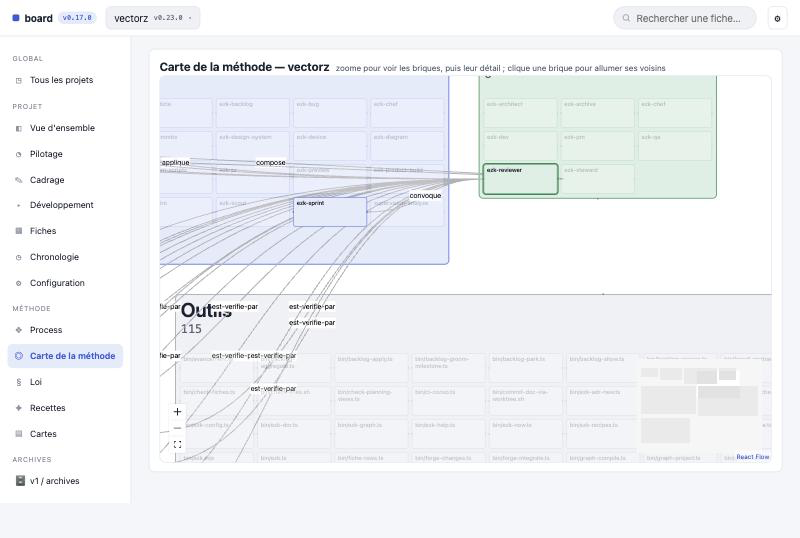
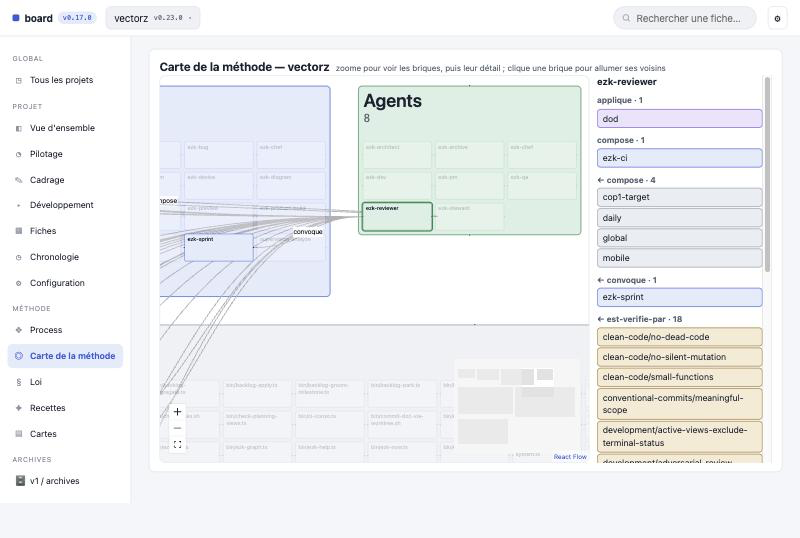
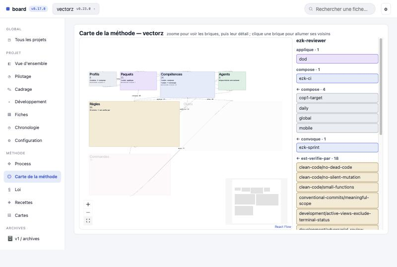

# 20261117122122557 — La carte de la méthode montre la sélection de loin, avec des liens lisibles

**En clair.** Sur la carte de la méthode, un clic sur une brique allume ses voisins, mais seulement de
près. Dès qu'on recule pour voir l'ensemble, la sélection disparaît. Et quand une brique a beaucoup de
liens, leurs libellés se chevauchent. On veut voir d'un coup d'œil où une brique est reliée dans toute la
méthode.

**Si tu arrives frais.** La carte de la méthode est une page de mission control (produit cop1). Elle a
trois niveaux : les familles de loin, les briques en s'approchant, le détail de près. Une brique est un
élément de la méthode : compétence, agent, règle, commande…

## Contexte / Problème

Vu dans le navigateur le 2026-11-17, à la livraison de la carte (fiche 20261117114544792) :

- un clic sur `ezk-reviewer` au niveau 2 dessine 25 liens et estompe 311 briques ;
- en recadrant toute la carte, on repasse au niveau 1 : la sélection n'est plus visible ;
- au niveau 2, les 25 libellés « est-vérifié-par », « compose »… se chevauchent.

## Proposition

1. Au niveau 1, quand une brique est sélectionnée, chaque famille affiche combien de voisins elle
   contient, par verbe (« Règles : 18 voisins · est-vérifié-par »), et les familles sans voisin
   s'estompent. La famille de la brique choisie dit son nom.
2. Au niveau 2, les liens de la sélection portent leur libellé une seule fois par verbe et par famille
   cible, au lieu d'un libellé par lien.
3. Un panneau à côté de la carte liste les voisins de la brique choisie, groupés par verbe, cliquables.

## Critères d'acceptation

- [x] Au niveau 1, avec une brique sélectionnée, chaque famille montre son nombre de voisins par verbe,
      et les familles sans voisin sont estompées.
- [x] Au niveau 2, les libellés des liens de la sélection ne se répètent pas pour un même verbe et une
      même famille cible.
- [x] Un panneau liste les voisins de la brique choisie par verbe ; un clic sur un voisin le sélectionne.
- [x] La projection reste une fonction pure, testée sur le contrat réel, sélection comprise.

## Comment vérifier

```bash
cd products/cop1/packages/web && pnpm exec tsc --noEmit && pnpm exec vitest run
```

- vue carte-methode : http://localhost:5281/ puis « Carte de la méthode », clic sur `ezk-reviewer`

**Avant / après** (règle `development/pr-before-after-media`), captures du 2026-11-17 :

| Vue | Avant (main) | Après (branche) |
|---|---|---|
| Clic sur ezk-reviewer |  |  |
| La même sélection, vue de loin | — |  |

## Notes / décisions

**Livraison du 2026-11-17.** Revue adverse `ezk-reviewer` : GO, 4 critères prouvés. Vérifié dans le navigateur sur le daemon réel : clic sur `ezk-reviewer` → panneau « applique · 1, compose · 1, ← compose · 4, ← convoque · 1, ← est-vérifié-par · 18 » ; vue de loin : Outils et Commandes estompés, les autres familles disent leurs voisins. Reste ouvert, non bloquant : pas de test composant du rendu du niveau 1 (la projection est testée).


- Origine : [rétro du sprint 2 du 17 novembre](../../docs/captures/2026-11-17-retro-sprint-2-tout-ce-qui-est-relie.md),
  proposition 3, retenue par délégation du PO absent. Suite directe de la demande du PO : voir ce qui
  est intriqué dans la méthode.
