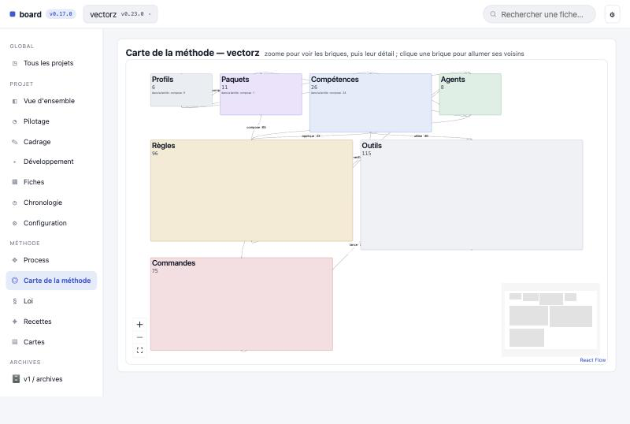
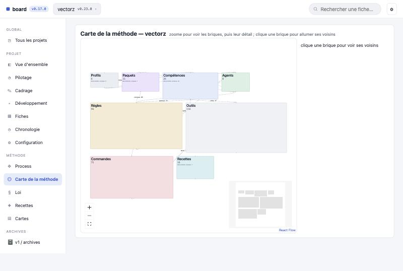
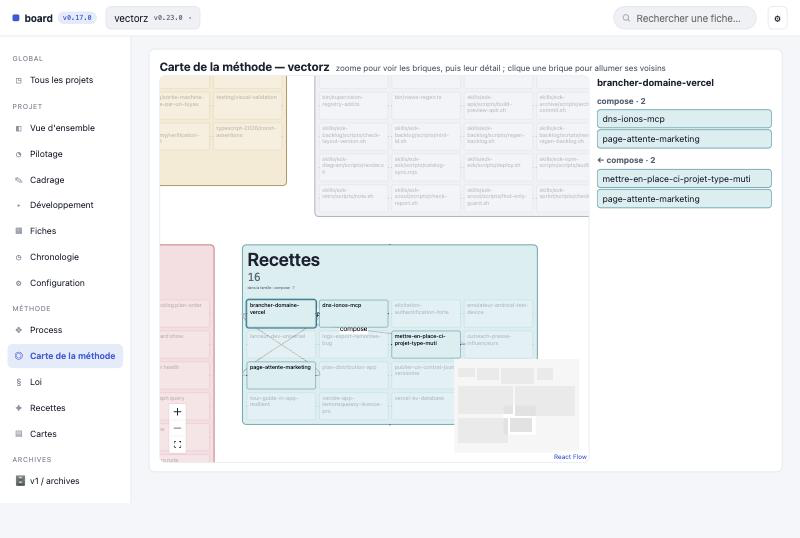

# 20261117140305053 — Les recettes entrent dans le graphe de la méthode et sur sa carte

**En clair.** La carte de la méthode montre maintenant les compétences, agents, règles, paquets,
profils, outils et commandes. Il manque les recettes : ces modes d'emploi que la méthode capitalise
(brancher un domaine Vercel, mettre en place une CI…). On les fait entrer dans le graphe, avec les
règles qu'elles composent, et la carte les affiche comme une huitième famille.

**Si tu arrives frais.** Une recette est un fichier `recipes/<nom>.md` à la racine de vectorz, avec un
front-matter dont le champ `composes:` liste d'autres recettes ou règles. Le graphe de la méthode est
publié par `ezk graph check --json` (contrat `graph-check/v1`) ; la carte de la méthode est une page de
mission control.

## Contexte / Problème

Demande du PO, le 2026-11-17 : voir tout ce qui est relié dans la méthode. La fiche
[Le graphe de la méthode en un contrat compilé](../20261114131614982_graphe-de-la-methode-en-contrat-compile.md)
prévoit que « les recettes sont des nœuds `recipe`, leurs `composes:` des arêtes compose ; une recette
que rien ne cite figure dans `orphans` ». C'est ce critère, découpé, plus son affichage sur la carte.

Les recettes sont lues par `ezk recipes` (`bin/ezk-recipes.ts`, dossier `recipes/` de la racine de la
méthode, `src/core/recipe-contract.ts`).

## Proposition

1. Une 8ᵉ sorte de brique, `recipe`, id = le nom du fichier sans `.md` ; `RECIPES.md` et
   `RECIPE_TEMPLATE.md` n'en sont pas. Ses `composes:` deviennent des liens `compose`, vers la cible là où
   elle existe (recette ou règle). Une recette que rien ne compose et qui ne compose rien figure dans
   `orphans`, sans faire échouer la commande.
2. Le contrat `graph-check/v1` reste en version 1 (ajout d'une sorte : additif) ; son schéma, son
   exemple et l'ADR des sortes le disent.
3. La carte de la méthode affiche une famille « Recettes », avec la même sélection et le même panneau.

## Critères d'acceptation

- [x] `ezk graph check --json` liste chaque recette de `recipes/` comme brique `recipe`, ses `composes:`
      comme liens `compose`, et aucun lien cassé de plus.
- [x] Une recette sans aucun lien figure dans `orphans`, sans faire échouer la commande.
- [x] Le schéma, l'exemple du contrat et l'ADR des sortes décrivent la sorte `recipe`.
- [x] La carte de la méthode montre une famille « Recettes » avec son compte ; un clic sur une recette
      allume ses voisins comme pour les autres briques.

## Comment vérifier

```bash
ezk graph check --json | python3 -c "import json,sys,collections; d=json.load(sys.stdin); print(collections.Counter(n['kind'] for n in d['nodes']))"
cd products/mega-city && pnpm gate
cd products/cop1/packages/web && pnpm exec vitest run
```

- vue carte-methode : http://localhost:5281/ puis « Carte de la méthode »

**Avant / après** (règle `development/pr-before-after-media`), captures du 2026-11-17 :

| Vue | Avant (main) | Après (branche) |
|---|---|---|
| Carte de la méthode, vue d'ensemble |  |  |
| Clic sur la recette brancher-domaine-vercel | — |  |

## Notes / décisions

**Livraison du 2026-11-17.** Revue adverse `ezk-reviewer` : GO, 4 critères prouvés sur la vraie sortie : 16 recettes, 7 liens recette → recette, 0 cassé, 9 recettes orphelines. Vu dans le navigateur : 8 familles, dont « Recettes · 16 » ; un clic sur `brancher-domaine-vercel` montre ce qu'elle compose et qui la compose. Restes ouverts, non bloquants : le daemon exige `nodeCount.recipe`, donc il refuserait le graphe d'une méthode plus ancienne (même motif que la sorte `command`) ; une recette dont le seul `composes:` est cassé n'est pas listée orpheline (elle l'est dans `broken`).


- Créée le 2026-11-17 par délégation du PO absent, après la rétro du sprint 5 : découpée de la fiche du
  graphe compilé, dont elle reprend un critère.
- Taille : deux surfaces (la sortie du graphe, la carte) et un amendement d'ADR ; la fiche reste entière parce que la carte n'a qu'une famille à ajouter et ne vaut rien sans la donnée (décision par délégation).
