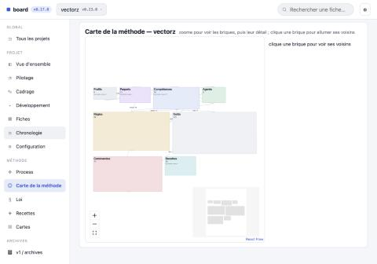
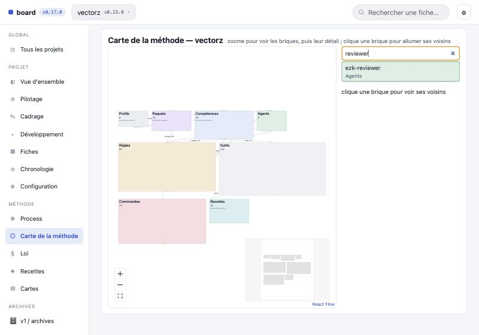
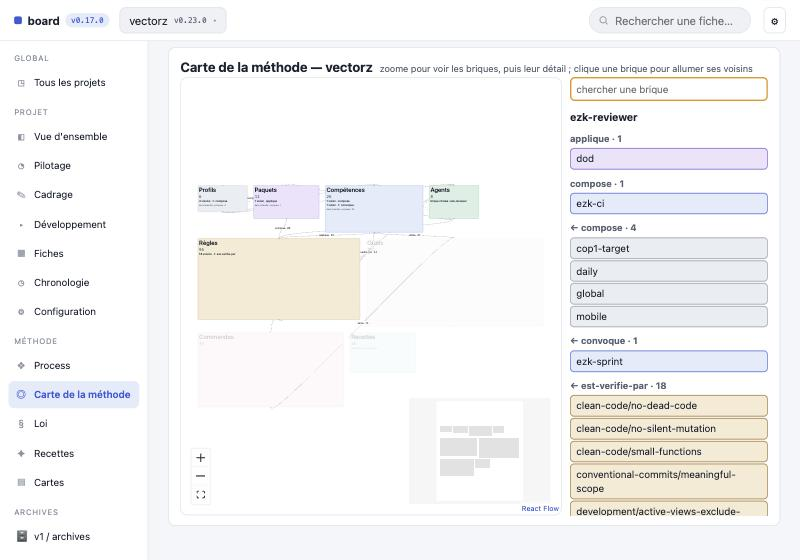

# 20261117153250174 — On cherche une brique par son nom sur la carte de la méthode

**En clair.** La carte de la méthode compte 352 briques. Pour voir les voisins de `ezk-reviewer`, il faut
zoomer, chercher la brique à l'œil, puis cliquer. On ajoute un champ de recherche au panneau des voisins :
on tape une partie du nom, la carte propose les briques qui correspondent, et un clic en choisit une.

**Si tu arrives frais.** La carte de la méthode (`GraphMap.tsx`, dans mission control) montre les briques
de la méthode ezk et leurs liens. Un panneau à droite liste les voisins de la brique choisie. « Choisir »
une brique, c'est la même action qu'un clic sur la carte.

## Contexte / Problème

Le PO testera la carte après le run du 17 novembre. Les deux exemples du guide de test sont
`ezk-reviewer` et la recette `brancher-domaine-vercel`. Sans recherche, il faut les trouver parmi
352 briques, au niveau de zoom des briques.

## Proposition

Un champ « chercher une brique » en tête du panneau des voisins.

- La saisie filtre les briques dont le nom contient le texte, sans tenir compte des majuscules.
- Les noms exacts passent en premier, puis l'ordre alphabétique.
- Au plus 8 propositions s'affichent, chacune avec sa famille. Au-delà, le panneau dit « 8 sur N ».
- Un clic sur une proposition choisit la brique. La touche Entrée choisit la première proposition.
- Aucun résultat : le panneau dit « aucune brique ne contient « texte » ».
- Le choix vide le champ.

Hors périmètre : déplacer la caméra sur la brique choisie.

## Critères d'acceptation

- [x] Taper `reviewer` propose `ezk-reviewer` avec sa famille ; un clic le choisit, et le panneau liste ses voisins.
- [x] Entrée choisit la première proposition ; un nom exact passe avant un nom qui le contient.
- [x] Plus de 8 résultats : 8 propositions et la mention « 8 sur N », N étant le vrai total.
- [x] Aucun résultat : la phrase « aucune brique ne contient « texte » » ; rien n'est choisi.

## Comment vérifier

```bash
cd products/cop1/packages/web && pnpm exec vitest run src/board/GraphMap.test.tsx src/board/graphProjection.test.ts
```

Dans mission control : page Carte de la méthode, taper `reviewer` dans le champ du panneau.

## Notes / décisions

- Créée et tirée au sprint 11 du 17 novembre, par délégation du PO absent : la recherche sert le test
  annoncé dans le résumé du run.

**Avant / après** (règle `development/pr-before-after-media`), captures du 2026-11-17 sur les vraies données de vectorz :

| Moment | Avant (main) | Après (branche) |
|---|---|---|
| Panneau des voisins |  |  |
| Après Entrée | — |  |

**Livraison du 2026-11-17.** Revue adverse `ezk-reviewer` : GO, 4 critères prouvés, gates vertes. Sa
réserve P2 est corrigée : un test d'écran lit maintenant « 8 sur 11 ». Deux réserves P3 restent ouvertes.
Un clic sur la carte laisse les propositions affichées, ce qui est conforme à la fiche. Le paramètre
`limit` garde sa valeur par défaut partout.
