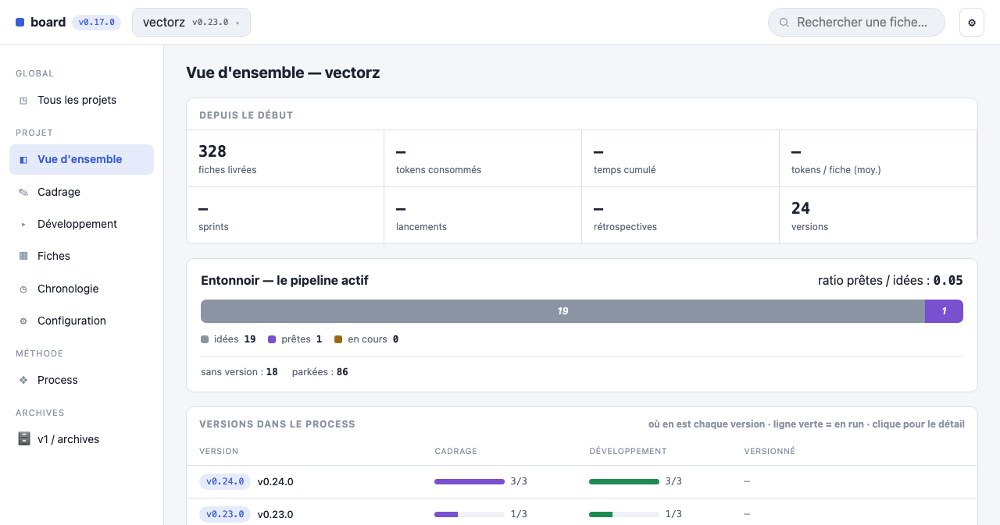

> 🗎 Rendu de la fiche [features/20261102095140835_mission-control-page-se-met-a-jour-seule.md](../done/20261102095140835_mission-control-page-se-met-a-jour-seule.md)

## En clair

Mission control montrait un chiffre périmé tant qu'on ne rechargeait pas la page. Le 2026-11-02,
la page affichait 327 fiches livrées alors que la méthode en comptait 328. Avec ce correctif, la page
redemande ses chiffres toute seule. Elle les corrige en quelques secondes à l'ouverture, et en moins
d'une minute si elle reste ouverte.

## Contexte / Problème

- Depuis le [branchement du 2026-11-01](../done/20261031160441412_mission-control-consomme-ezk.md),
  le daemon de mission control garde la dernière réponse d'`ezk` et la relit en arrière-plan quand
  elle a plus de 30 secondes. C'est voulu : la page n'attend jamais.
- Mais la page ne redemandait ses chiffres qu'au chargement. Le daemon relisait bien la méthode,
  mais la page ne venait jamais chercher la nouvelle copie.
- Le 2026-11-02 à 10 h, le PO a ouvert mission control lancé à 0 h 24. La page a montré la copie de
  0 h 24 : 327 livrées et une fiche en cours. La méthode disait 328 livrées et aucune en cours. Il a
  fallu recharger pour voir le vrai chiffre.

## Valeur

- Le PO peut laisser mission control ouvert et s'y fier : ce qu'il voit suit la méthode.
- À l'ouverture, il ne lit plus un chiffre vieux de plusieurs heures sans le savoir.

## Proposition

1. **Le daemon dit qu'il relit.** Quand il sert sa copie pendant qu'il interroge `ezk`, l'état de la
   lecture porte `refreshing: true`.
2. **La page redemande seule.** Elle redemande toutes les 2 secondes tant qu'une lecture se charge ou
   se relit. Sinon, elle redemande toutes les 15 secondes. Chaque demande est servie depuis la copie du
   daemon, sans attendre.
3. **La page revient seule quand le daemon revient.** Si le daemon ne répond pas, la page le dit, puis
   redemande toutes les 15 secondes.

La méthode n'est pas plus sollicitée qu'avant : le daemon ne relance `ezk` qu'au plus une fois toutes
les 30 secondes par projet, et seulement quand une page regarde.

## Critères d'acceptation

- [x] **Page laissée ouverte.** Une fiche change dans le projet : la page ouverte montre le nouveau
      chiffre en moins d'une minute, sans recharger.
- [x] **Ouverture après une pause.** Le daemon sert une copie ancienne et relit la méthode : la page
      montre le chiffre à jour en quelques secondes, sans recharger.
- [x] **Daemon revenu.** Le daemon ne répond plus, puis répond de nouveau : la page dit d'abord
      « injoignable », puis montre le board sans recharger.
- [x] **Pas d'appel en plus à la méthode.** Entre deux relectures, le daemon répond de sa copie ;
      `ezk` n'est relancé qu'au plus une fois toutes les 30 secondes par projet.
- [x] **Avant / après.** Deux captures d'une page restée ouverte pendant qu'une fiche change :
      avant le correctif, le chiffre ne bouge pas ; après, il suit.

## Comment vérifier

```bash
pnpm cop1:dev
```

Ouvrir http://localhost:5273 et laisser la page ouverte. Dans un autre terminal, livrer ou créer une
fiche, puis comparer avec `ezk board show`. Signal observable : en moins d'une minute, la tuile
« fiches livrées » et l'entonnoir montrent les chiffres de la méthode, sans recharger.

## Avant / après

Une page de mission control reste ouverte. Une fiche livrée apparaît dans le projet : la méthode
passe de 328 à 329 fiches livrées. On regarde la page 60 secondes plus tard, sans la recharger.

| Départ (les deux cas) | Avant le correctif, 60 s après | Après le correctif, 60 s après |
|---|---|---|
|  |  |  |

Mesure du délai, après le correctif : la page a montré 329 au bout de 27 secondes.

## Notes

- Bug de la [fiche « mission control consomme ezk »](../done/20261031160441412_mission-control-consomme-ezk.md),
  constaté le 2026-11-02. Priorité P2, reprise de la fiche mère.
- Le délai de relecture du daemon reste à 30 secondes. Un envoi par le serveur (SSE) éviterait les
  demandes répétées, mais la demande toutes les 15 secondes coûte une lecture en mémoire : on garde le
  plus simple.
- Revue adverse du 2026-11-02 : GO. Elle a relevé un effet de la relecture toutes les 15 secondes : une
  fiche livrée pendant qu'on lit sa fenêtre quittait les données, et la fenêtre se fermait seule. La
  fenêtre garde désormais le dernier détail affiché (test ajouté, rouge avant).


## Validation

| Modalité | Statut |
|---|---|
| Tests mission control (706 daemon + 117 page) | ✅ |
| Types (tsc -b et typecheck web) | ✅ |
| Lint des fichiers touchés | ✅ (3 défauts préexistants hors patch) |
| Preuve page ouverte | ✅ 328 puis 329 en 27 s sans recharger |
| Revue adverse ezk-reviewer | ✅ GO (1 constat non bloquant corrigé) |
| Before / after (UI) | [avant](../../docs/pr-evidence/20261102095140835/page-ouverte-before-t60.png) · [après](../../docs/pr-evidence/20261102095140835/page-ouverte-after-t60.png) |
