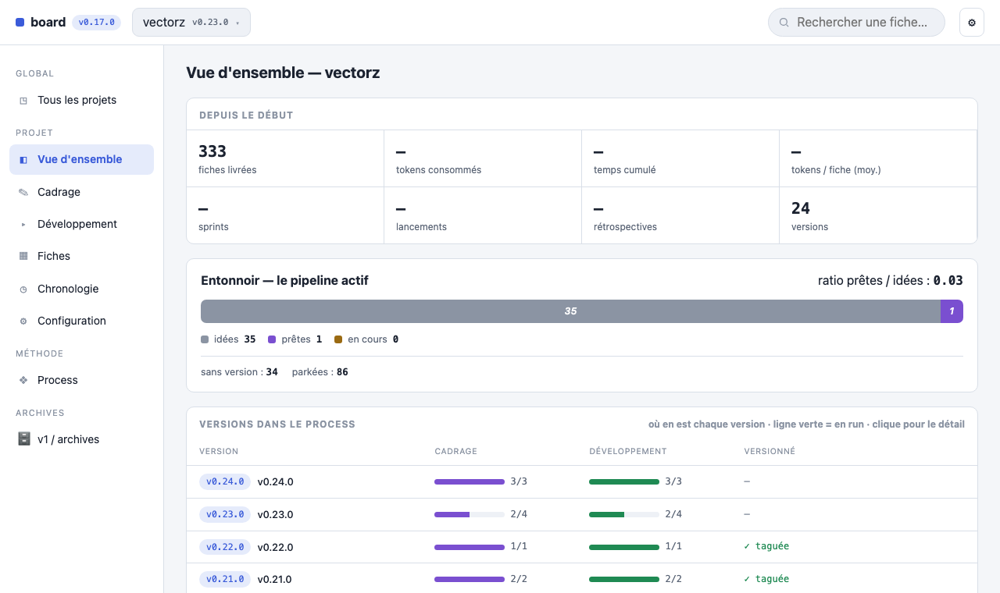
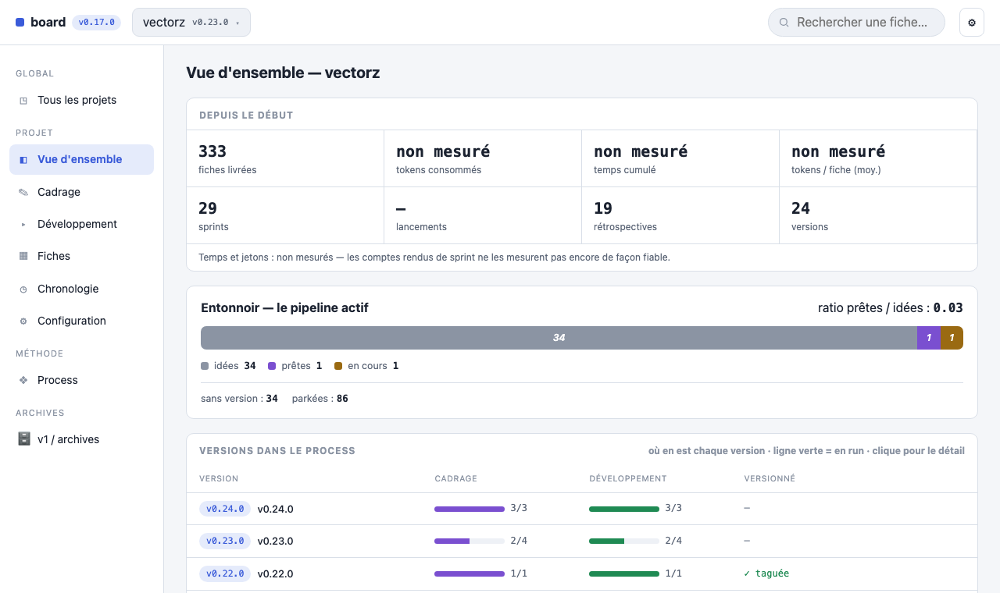

> 🗎 Rendu de la fiche [features/20261102104443762_vue-ensemble-sprints-retros-reels.md](../20261102104443762_vue-ensemble-sprints-retros-reels.md)

## En clair

La vue d'ensemble de mission control affiche un tiret dans cinq tuiles sur huit. Ce n'est pas une
panne : ces tuiles n'ont jamais été reliées à de vraies données. Les chiffres qu'on y voyait avant
venaient de l'échantillon de démonstration. Cette fiche remplit les deux tuiles que la méthode sait
compter, sprints et rétrospectives. Les trois autres disent en mots qu'elles ne sont pas mesurées.

## Contexte / Problème

- Le 2026-11-02, le PO a ouvert la vue d'ensemble de vectorz : « on ne voit plus les données des
  KPIs ». Les tuiles jetons consommés, temps cumulé, jetons par fiche, sprints et rétrospectives
  affichent « — ».
- Ces tuiles n'ont jamais eu de source réelle. Le daemon les pose à « — » depuis qu'il sert le vrai
  plan (2026-10-24), pour ne jamais montrer un faux zéro. Avant, la page retombait sur l'échantillon
  de démonstration : 18,4 M jetons, ~42 h, 120 sprints, 14 rétros. Depuis le
  [branchement du 2026-11-01](../done/20261031160441412_mission-control-consomme-ezk.md), la page ne
  montre plus jamais cet échantillon.
- La méthode sait pourtant compter deux de ces chiffres. Le 2026-11-02, vectorz a 27 comptes rendus
  de sprint (`docs/sprints/`) et 19 rétros capturées (`docs/captures/*-retro-*.md`).
- Les trois autres chiffres ne sont pas fiables aujourd'hui. Sur les 27 comptes rendus, 23 ont une
  durée de 0 et 3 seulement une durée mesurée. Parmi ces 3, deux sont absurdes : 390 heures et
  3,5 milliards de jetons pour un sprint d'une soirée, 3 milliards de jetons pour un sprint de
  8 minutes. Les additionner afficherait un faux chiffre.

## Valeur

- Le PO voit combien de sprints et de rétros la méthode a menés, sans ouvrir de dossier.
- Une tuile vide dit pourquoi elle est vide : on ne la prend plus pour une panne.

## Proposition

1. **La méthode publie ses deux comptes.** `ezk board show --json` gagne le nombre de comptes rendus
   de sprint et le nombre de rétros capturées. Les dossiers se lisent par la config du projet, comme
   `ezk retro reports` : un projet hôte est compté chez lui. Le contrat `board-show` décrit ces champs.
2. **Mission control les affiche.** Les tuiles « sprints » et « rétrospectives » montrent ces deux
   nombres.
3. **Les tuiles non mesurées le disent.** Temps cumulé, jetons consommés et jetons par fiche affichent
   « non mesuré », avec une phrase courte : les comptes rendus de sprint ne mesurent pas encore la
   durée ni les jetons de façon fiable.

## Critères d'acceptation

- [x] **Mêmes comptes que la méthode.** Les tuiles « sprints » et « rétrospectives » valent les deux
      comptes publiés par `ezk board show --json` pour le projet affiché. Pour vectorz, au build du
      2026-11-02 : 29 et 19 (27 à la rédaction : deux sprints se sont ajoutés le jour même).
- [x] **Un vrai zéro.** Un projet sans compte rendu ni rétro affiche 0 dans ces deux tuiles, car la
      méthode a compté.
- [x] **Ce qui n'est pas mesuré le dit.** Temps cumulé, jetons consommés et jetons par fiche
      affichent « non mesuré » et leur raison en une phrase, jamais un chiffre tiré des comptes rendus
      actuels.
- [x] **Méthode plus ancienne.** Si `ezk board show --json` ne porte pas ces comptes, les deux tuiles
      affichent « — » et la raison, jamais 0.
- [x] **Avant / après.** Capture de la vue d'ensemble de vectorz avant (cinq tirets) et après.

## Comment vérifier

```bash
ezk board show --json | jq '.historique'
pnpm cop1:dev
```

Ouvrir http://localhost:5273, vue d'ensemble de vectorz. Signal observable : les tuiles « sprints » et
« rétrospectives » valent les deux comptes du JSON. Les trois tuiles de temps et de jetons disent
« non mesuré ». Le nom du champ `historique` est à fixer au build, dans le contrat.

## Avant / après

| Avant : cinq tuiles muettes | Après : les vrais comptes, et ce qui n'est pas mesuré le dit |
|---|---|
|  |  |

## Notes

- Priorité P1, fixée par le PO le 2026-11-02.
- Le temps et les jetons attendent une mesure fiable :
  [Un compte rendu de sprint non daté le dit d'emblée](../20261101131506082_compte-rendu-de-sprint-non-date-sans-faux-zero.md).
  Une fois cette mesure réparée, une fiche courte branchera ces trois tuiles.
- Le détail des jetons par run est une autre fiche, bloquée par un panel :
  [Board : enrichir les runs (moments + jetons)](../20261026132118384_board-enrichir-runs-moments-jetons.md).
- La tuile « lancements » compte déjà les runs observés : elle n'est pas concernée.
- **Taille.** Cinq critères, deux surfaces : la commande `ezk board show` et la page. La fiche reste
  entière.
- Revue adverse du 2026-11-02 (sprint 7 du run autonome) : GO, cinq critères prouvés. Deux remarques non
  bloquantes : l'historique se lit en tout ou rien (un champ mal formé masque les deux tuiles) ; le
  dossier `docs/sprints/` est fixe, comme pour `ezk retro reports`.


## Validation

| Modalité | Statut |
|---|---|
| Gate de la méthode (2389 tests) | ✅ |
| Tests mission control (714) | ✅ |
| Types (typecheck web) | ✅ |
| Lint des fichiers touchés | ✅ (3 défauts préexistants hors patch) |
| Contrat board-show v1 | ✅ champ historique ajouté sans changer de version |
| Revue adverse ezk-reviewer | ✅ GO (2 remarques non bloquantes) |
| Before / after (UI) | [avant](../../docs/pr-evidence/20261102104443762/vue-ensemble-before.png) · [après](../../docs/pr-evidence/20261102104443762/vue-ensemble-after.png) |
