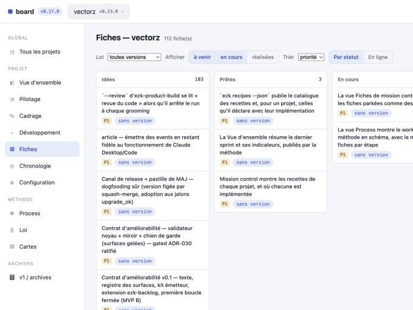

> 🗎 Rendu de la fiche [features/20261104090517494_fiches-parkees-montrees-comme-idees.md](../done/20261104090517494_fiches-parkees-montrees-comme-idees.md)

# 20261104090517494 — La vue Fiches montre les fiches parkées comme des idées

**En clair.** La vue Fiches de mission control annonce 103 idées pour vectorz. Il n'y en a que
18 : les 85 autres sont parkées, c'est-à-dire sorties du travail en attendant le PO. Mission control
les mélange aux idées : la méthode compte les parkées, mais ne dit pas lesquelles. La méthode
publiera l'état de chaque fiche, et la vue Fiches rangera les parkées à part, cachées par défaut.

**Si tu arrives frais.** Une fiche « parkée » porte `milestone: parked` : elle reste au backlog mais
n'entre dans aucun sprint tant que le PO ne la réveille pas.

## Contexte / Problème

Constaté le 2026-11-04 sur l'instance de mission control de vectorz :

- Vue Fiches : « Idées 103 ».
- Vue Process et Vue d'ensemble : « idées 18 », « parkées 85 ».

Deux écrans du même produit se contredisent. La cause : `ezk board show --json` publie le compte
`parkees`, mais `ezk backlog show --json` ne dit pas, fiche par fiche, laquelle est parkée. Le
traducteur du daemon (`products/cop1/packages/app/src/features/board/ezkPlanTranslator.ts`, fonction
`ficheStatus`) range donc toute fiche non prête en « idea ».

## Proposition

La méthode dit quelles fiches sont parkées ; mission control lit sa réponse (ADR-086 : la méthode
interprète, mission control affiche).

- **La méthode** publie, pour chaque fiche de `ezk backlog show --json`, un booléen `parkee`. Elle
  le calcule avec la même règle que le compte `parkees` de `ezk board show --json` : une idée rangée
  dans la milestone `parked`. Le contrat `backlog-show` v1 le décrit. Une seule règle, partagée,
  au lieu des trois copies de `isParked` qui existent aujourd'hui.
- **Le traducteur du daemon** donne l'état `parked` à une fiche que la méthode publie `parkee: true`.
  Il ne lit pas `milestone` pour le deviner.
- **La vue Fiches** range ces fiches dans une colonne « Parkées », cachée par défaut derrière une case
  « montrer les parkées ».

Trois surfaces : la commande, le serveur, l'écran. La fiche reste entière : côté méthode, c'est un
booléen calculé par une règle qui existe déjà ; le découper laisserait un champ publié sans lecteur.

## Critères d'acceptation

- [x] `ezk backlog show --json` publie `parkee: true` pour une idée de la milestone `parked`, et
      `false` pour toute autre fiche ; le schéma du contrat `backlog-show` v1 le décrit.
- [x] La règle « parkée » vit à un seul endroit de la méthode, partagé par `backlog show`,
      `board show` et le process.
- [x] Le traducteur du daemon donne l'état `parked` à une fiche publiée `parkee: true`, sans lire
      `milestone` ; une fiche prête ou livrée garde son état.
- [x] Par défaut, la vue Fiches n'affiche pas les parkées, et son compte d'idées égale celui de la
      Vue d'ensemble ; une case « montrer les parkées » fait apparaître la colonne « Parkées ».
- [x] Les tests de la méthode, du traducteur et de la vue couvrent ces cas.

## Comment vérifier

```bash
ezk backlog show --json | jq '[.fiches[] | select(.parkee)] | length'   # = parkées de la Vue d'ensemble
pnpm --dir products/mega-city test -- backlog-show
pnpm vitest run products/cop1/packages/app/src/features/board
pnpm --dir products/cop1/packages/web exec vitest run src/board
```

Puis ouvrir mission control, vue Fiches de vectorz : le compte d'idées égale celui de la Vue
d'ensemble, et la case montre la colonne « Parkées ».

Avant / après, vue Fiches de vectorz (2026-11-04) :

- avant : « Idées 103 », les 85 parkées mêlées aux idées — 
- après : « Idées 18 », comme la Vue d'ensemble, et la bascule « montrer les parkées (85) » — 

## Notes / décisions

- Lot « mission control lisible » du run du 2026-11-04 : le PO veut des fiches « dans les bons
  états ».
- Preuve avant/après : capture de la vue Fiches.
- 2026-11-04 : `ezk-pm` n'a pas concouru sur la première version, qui faisait dériver l'état dans le
  traducteur de mission control (contraire à l'ADR-086 §1.3). Proposition réécrite : la méthode
  publie `parkee` par fiche.


## Validation

| Modalité | Statut |
|---|---|
| Gate locale | ✅ |
| Revue | ✅ GO ezk-reviewer |
| Before / after (UI) | ✅ docs/pr-evidence/20261104090517494/ |
