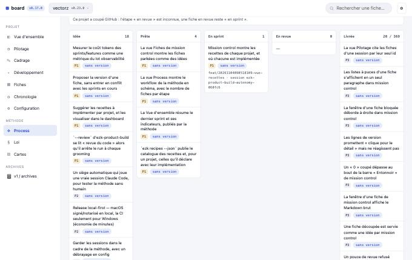
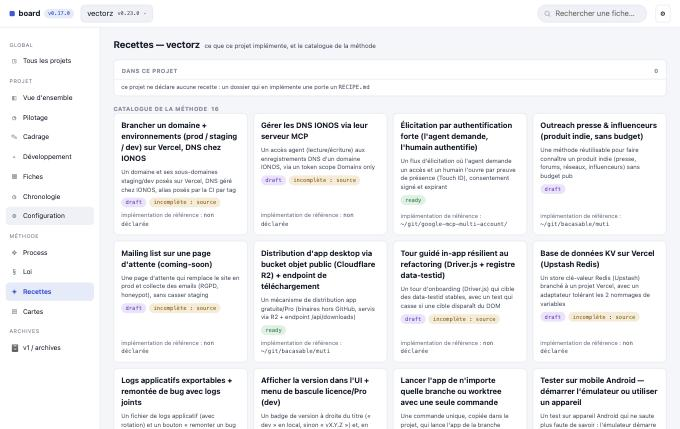

> 🗎 Rendu de la fiche [features/20261104090518109_mission-control-montre-les-recettes.md](../done/20261104090518109_mission-control-montre-les-recettes.md)

# 20261104090518109 — Mission control montre les recettes de chaque projet

**En clair.** Mission control n'a aucun écran pour les recettes. On ajoute une vue « Recettes » :
le catalogue de la méthode, et, pour le projet affiché, les recettes qu'il déclare avec le dossier
qui les implémente. Les données viennent de `ezk recipes --json` ; la page ne devine rien.

**Si tu arrives frais.** Une recette est un pattern réutilisable (`recipes/*.md`). Un projet la
déclare en posant un `RECIPE.md` dans le dossier qui l'implémente.

## Contexte / Problème

Le PO demande le 2026-11-04 : « recettes affichées et leurs implémentations indiquées pour chaque
projet ». Aujourd'hui la barre de gauche de mission control n'a pas d'entrée « Recettes ».

## Proposition

- **Le daemon** appelle `ezk recipes --json --root <projet>` pour le projet affiché, comme il le fait
  déjà pour le board, et sert le résultat à la page.
- **La vue « Recettes »**, dans la section Méthode de la barre de gauche :
  - en haut, « Dans ce projet » : une ligne par recette déclarée, avec son titre et le dossier qui
    l'implémente ;
  - en dessous, « Catalogue de la méthode » : une carte par recette, avec ce qu'elle fabrique, son
    statut, son implémentation de référence, et une marque « utilisée ici » si le projet la déclare ;
  - une recette incomplète porte une étiquette qui nomme les champs manquants.
- Sans données, la vue dit pourquoi, comme la vue Process.

Deux surfaces : le serveur et l'écran.

## Critères d'acceptation

- [x] La barre de gauche propose une entrée « Recettes » qui ouvre la vue.
- [x] La vue liste les recettes déclarées par le projet affiché, chacune avec le dossier qui
      l'implémente.
- [x] La vue liste le catalogue de la méthode, chaque recette avec ce qu'elle fabrique, son statut
      et son implémentation de référence ; celles que le projet déclare portent « utilisée ici ».
- [x] Changer de projet dans le sélecteur change la partie « Dans ce projet ».
- [x] Si la méthode ne répond pas, la vue affiche la raison au lieu d'une page vide.
- [x] Les tests du daemon et de la vue couvrent ces cas.

## Comment vérifier

```bash
pnpm vitest run products/cop1/packages/app/src/features/board
pnpm --dir products/cop1/packages/web exec vitest run src/board
```

Puis ouvrir mission control, vue « Recettes » : le catalogue s'affiche, et la partie projet suit le
sélecteur.

Avant / après, mission control sur vectorz (2026-11-04) :

- avant : la section Méthode n'a que Process, Loi et Cartes, aucune recette visible — 
- après : l'entrée « Recettes », la partie « Dans ce projet » (vectorz n'en déclare aucune, la vue dit comment en déclarer une) et le catalogue de 16 recettes, chacune avec ce qu'elle fabrique, son statut, ses champs manquants et son implémentation de référence — 

Constat du 2026-11-04 : aucun des trois projets enregistrés (vectorz, samplerz, muti) ne déclare encore de `RECIPE.md` ; la partie « Dans ce projet » est donc vide partout, et c'est la vérité.

## Notes / décisions

- Dépend de [`ezk recipes --json`](../done/20261104090518008_ezk-recipes-json.md).
- Découpée de la fiche [Suggérer les recettes à implémenter par projet](../20261029093423195_suggerer-recettes-par-projet-dashboard.md) :
  l'affichage part maintenant, la suggestion attend sa maquette.
- Preuve avant/après : capture de la barre de gauche et de la vue.


## Validation

| Modalité | Statut |
|---|---|
| Gate locale | ✅ |
| Revue | ✅ GO ezk-reviewer |
| Before / after (UI) | ✅ docs/pr-evidence/20261104090518109/ |
