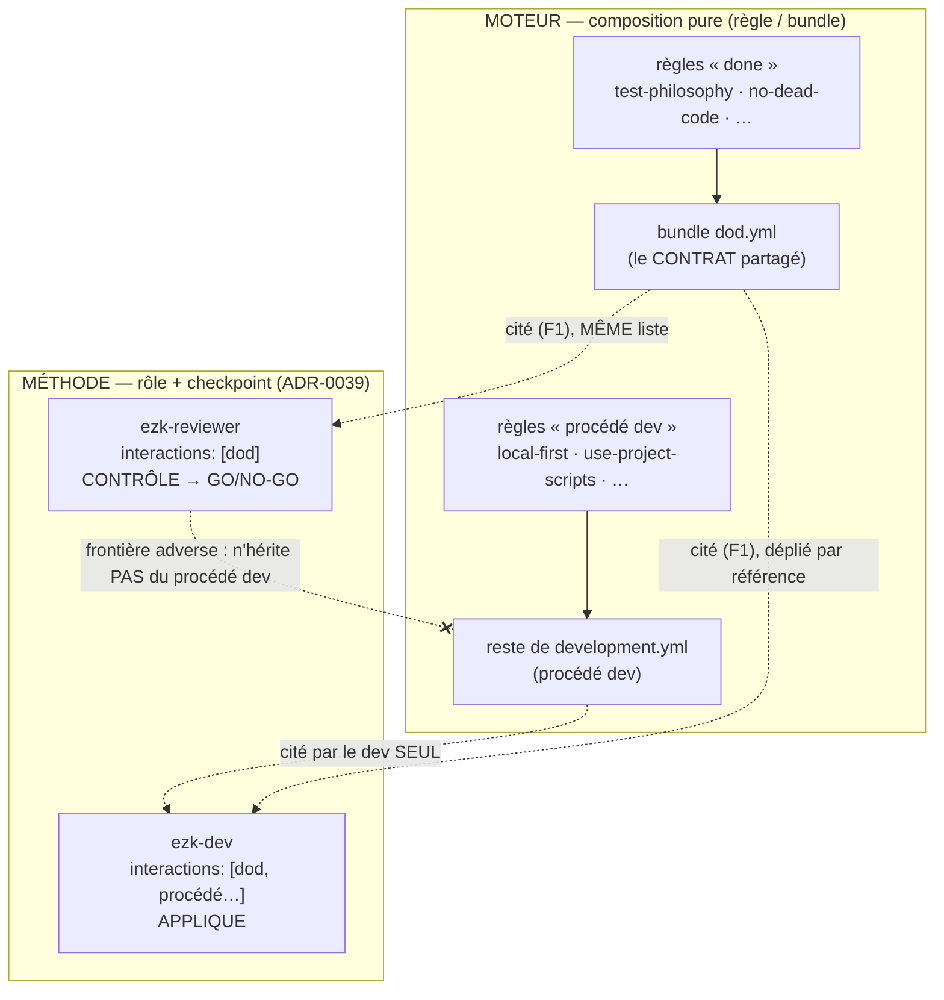

# ADR 0070 — DoD et DoR : un bundle qui joue le rôle de contrat partagé (amende ADR-0016 et ADR-0050)

- Statut : **accepté** (décision de conception `ezk-architect`, fiche `20261008154804532`)
- Date : 2026-10-10
- Amende : [ADR-0016](0016-rituels-scrum-cycle-de-vie-backlog.md) (cycle DoR) et [ADR-0050](0050-couche-regles-projet-local.md) (couche `.vectorz/`)
- Compose / respecte : [ADR-0039](0039-trois-etages-moteur-methode-branchements-plugin.md) (frontière moteur/méthode), [ADR-0029](0029-fiche-est-le-document-pr-en-est-le-rendu.md) (source unique), [ADR-0059](0059-revue-locale-plancher-codex-filet-pr-optionnelle-par-config.md) (frontière adverse), [ADR-0040](0040-modele-fichiers-ezk-compile-schema-valide.md) (modèle de fichiers), F1 (`20261008154803440` — un consommateur cite un bundle)

## En clair

La **DoD** (« quand est-ce fini ? ») est un **bundle** : `bundles/dod.yml`. Rien de neuf dans le modèle. Le dev (`ezk-dev`) **et** le relecteur (`ezk-reviewer`) le citent dans leur liste `interactions:`, et F1 le déplie en **la même liste de règles des deux côtés**. Fini la recopie à la main.

Le « ce n'est **pas** un bundle » de la fiche devient précis : ce n'est pas un **nouveau kind**, et ce n'est pas un bundle de **procédé** du dev. C'est un bundle qui **joue le rôle** de DoD. Le rôle (qui applique, qui contrôle, à quel checkpoint) ne vit pas dans le fichier — il vit dans la **méthode** (ADR-0039). Le fichier, lui, est juste un sac de règles.

La **DoR** ne bouge pas : sa config de checkpoint reste dans `.vectorz/dor.yml`. Seul le *contenu* de ses critères pourra, plus tard, référencer un bundle.

## Contexte / Problème

Le nœud de la fiche semble se contredire : une DoD serait « une liste qui référence des règles et/ou des bundles », « **pas** un bundle », et « **aucun nouveau kind** ». Trois contraintes qu'il faut réconcilier dans le modèle réel (`docs/domain.ts`, kinds : `rule`, `agent`, `skill`, `bundle`, `profile`, `cap`).

Or une liste qui référence des règles **et** des bundles, c'est **littéralement** l'interface `Bundle` :

```ts
export interface Bundle {
  id: string;
  extends?: string[]; // ids d'autres Bundles → composition
  rules: string[];    // ids de Rules
}
```

Un bundle **compose** déjà (`extends`). Donc « une liste qui compose, pas un bundle » n'a pas de représentation distincte : aucun autre kind n'est « un sac de règles composable ». Les trois contraintes ne sont tenables **ensemble** que si l'une plie. La plus faible est le mot « bundle » : l'**intention** derrière « pas un bundle » — *une DoD est plus qu'un sac bête, elle porte un rôle* — se préserve en plaçant le rôle dans la **méthode**, pas en inventant un type de fichier.

Deux douleurs à résoudre, par ailleurs :

- **Recopie manuelle.** `ezk-reviewer` liste 5 règles en dur dans `interactions:`. Le dev en déclare 1. Le contrat **appliqué** (dev) et le contrat **contrôlé** (reviewer) peuvent diverger — le spike `20261008183238365` l'a prouvé. Entorse à la source unique (ADR-0029).
- **Bundle fourre-tout.** `development.yml` (18 règles) **mélange** le procédé du dev (`local-first-feedback`, `use-project-scripts`…) et des critères de « done » à contrôler (`test-philosophy`, `adversarial-review-before-merge`…).

## Décision

### D1 — La DoD est un bundle, `bundles/dod.yml` (zéro nouveau kind, réutilise F1)

La DoD se représente par un **bundle** dédié. Il ne contient **que** des critères de « done » (propriétés **observables sur l'incrément fini**), jamais du procédé dev. Exemple d'intention (la composition exacte est du travail de build) :

```yaml
# bundles/dod.yml — le CONTRAT « fini ». Un bundle (moteur) qui joue le RÔLE de DoD (méthode).
# Rôle = qui le cite + à quel checkpoint, pas dans ce fichier (ADR-0039).
id: dod
rules:
  - development/acceptance-criteria-before-merge
  - development/test-philosophy
  - development/adversarial-review-before-merge
  - development/pr-before-after-media
  - development/host-project-proof-before-ship
  - clean-code/no-dead-code
  - clean-code/no-silent-mutation
  - testing/confinement-contract-at-boundary
```

### D2 — Une seule liste, lue des deux côtés via F1

`ezk-dev.interactions` **et** `ezk-reviewer.interactions` citent l'**id** `dod`. F1 (`appliedRuleIds`) le déplie **par référence** en la même liste de règles. Les 5 règles recopiées à la main dans `ezk-reviewer` sont **remplacées** par la citation `dod`. Zéro recopie : la source est unique (ADR-0029).

### D3 — Frontière adverse préservée (ADR-0059) : le reviewer n'hérite pas du procédé dev

Trois cercles, qui ne se mélangent pas :

- **DoD (partagé)** = `bundles/dod.yml` : cité par le dev **et** le reviewer. Propriétés du **résultat**.
- **Procédé dev (dev seul)** = ce qui reste de `development.yml` une fois les critères de « done » sortis vers `dod.yml` : `local-first-feedback`, `handle-blockers`, `use-project-scripts`, `quality-guardrails`, `playwright-mcp-usage`, `run-freshness-origin-main`, `command-reproducibility`, `merge-when-absent-default`, `worktree-secondary-inline-harvest`, `fiche-read-via-loader`, `one-story-one-commit-local`, `workaround-traceability`. **Jamais** cité par le reviewer.
- Le reviewer cite **la DoD, point** (plus ses angles morts, qui sont de la **méthode** dans son prompt, pas des règles héritées du dev).

Invariant : `appliedRuleIds(reviewer.interactions)` ne contient **aucune** règle du procédé dev. Le reviewer attaque le **résultat**, pas la recette du dev — c'est ce qui garde la revue indépendante.

### D4 — Honnêteté ADR-0050 : ce qui est garanti, c'est le contrat chargé, pas le code conforme

Déclarer que le dev « applique » la DoD ne crée **aucune** fausse garantie. Ce que le moteur garantit, **vérifiable** au `graph:check` : le **même** bundle `dod` est **cité** (`interactions:`) des deux côtés et se déplie en la **même** liste de règles. C'est déterministe et testable (un test assure que les deux côtés déplient `dod` au même jeu) — au niveau du **catalogue/graphe**.

Précision d'honnêteté décisive : l'en-tête `interactions:` est de la **métadonnée de catalogue/graphe**, **retirée avant la construction du prompt** — le modèle ne la lit jamais (`src/core/law-coverage.ts`). Le changement `interactions: [dod]` unifie donc le contrat **déclaré** (une seule source, auditable), il ne modifie **pas** le prompt que le modèle lit, ni côté dev ni côté reviewer. L'enforcement réel du reviewer reste sa **prose** + le cliquet `law-coverage` (`rule.enforcements: agent-check`) — **inchangé** par ce patch. Ce qui **n'est pas** mécanisé, et qu'on ne prétend donc pas : que le dev écrive du code conforme. Le **contrôle** est le **GO/NO-GO du reviewer** — le vrai gate (aucun merge sans son GO, ADR-0059). On sépare « règle **déclarée/chargée** » (déterministe, catalogue) de « règle **appliquée** » (prose + gate), exactement comme ADR-0050. La DoD ne porte donc **pas** un `enforcement: gate` propre ; son gate est la revue adverse.

### D5 — DoR : config préservée, contenu migrable plus tard

La *config de checkpoint* DoR (`slots`, `heading`, `items`, `health.min-ready`) **reste** dans `.vectorz/dor.yml` : c'est de la configuration par projet (ADR-0016 amendement 2026-10-01, ADR-0050), pas une liste de règles. Seul le *contenu des critères* d'un slot pourra, dans une suite, référencer un bundle. Le POC **ne touche pas** `dor.yml`. Aucun `kind` nouveau nulle part.



*Légende : en haut le moteur (des bundles, sacs de règles) ; en bas la méthode (les rôles). Flèche pleine = appartenance d'une règle à un bundle. Flèche pointillée = un rôle **cite** un bundle (via F1). La flèche barrée en rouge-texte dit l'invariant d'ADR-0059 : le reviewer ne cite jamais le procédé dev. `dod` est le seul bundle cité **des deux côtés** — c'est lui, le contrat partagé.*

## Options écartées

- **Nouveau kind `dod` / `contract`** dans `domain.ts` — un second type « sac de règles composable » qui double `Bundle` (DRY/YAGNI), avec loader + arêtes de graphe à écrire, pour **zéro** capacité que F1 ne donne déjà. Et ça viole « aucun nouveau kind ».
- **DoD = un `Profile`** — le profil est le **dossier de bind** (règles + agents + skills pour une cible de déploiement), sémantique plus lourde ; une DoD n'est qu'un jeu de règles → erreur de catégorie.
- **Pas de fichier : recopier la liste dans les deux `interactions:`** — c'est exactement la recopie manuelle que la fiche tue ; aucune source unique.
- **DoD en prose dans le playbook `ezk-sprint`** — ni composable machine, ni lue des deux côtés, ni vérifiable au `graph:check`.

## Conséquences

**Plus facile** — une seule source pour « fini », **déclarée** par le producteur et le vérificateur ; la divergence de déclaration prouvée par le spike disparaît ; le contrat partagé est **auditable** (`graph:check` vérifie que les deux côtés déplient le même jeu). Le tri procédé/critères qui rendrait `development.yml` lisible n'est **pas** dans ce POC (les règles de « done » y restent, dupliquées avec `dod`, sans conséquence fonctionnelle) : il part en suite (voir Périmètre).

**Plus dur / à surveiller** — « DoD = bundle » demande une **convention de nommage** pour ne pas confondre un bundle de composition (`base`, `clean-code`) et le bundle-contrat (`dod`) : l'en-tête du fichier et cet ADR portent la distinction, pas le modèle. Le classement d'une règle « procédé » vs « done » est un **jugement** (cas limites : `one-story-one-commit-local`, `workaround-traceability` ont une signature visible dans le résultat → ils peuvent légitimement rejoindre la DoD ; tranché au build, sous l'œil du reviewer). La DoD ne « garantit » rien par elle-même : son gate reste le GO du reviewer (ne jamais la présenter comme un gate mécanique).

## Périmètre

**POC livrable maintenant** (critères de la fiche) :

1. Créer `bundles/dod.yml` avec les critères de « done ».
2. `ezk-dev.interactions` et `ezk-reviewer.interactions` citent `dod` ; retirer la recopie manuelle du reviewer.
3. Un test (`dod-contract.test.ts`) : les deux côtés déplient `dod` au **même** jeu (via `appliedRuleIds`, F1), et `dod` ne contient **aucune** règle de procédé dev.
4. `graph:check` + la suite verts ; `.vectorz/dor.yml` intact.

**Suites (fiches sœurs, ne pas fusionner)** :

- **Décontaminer `development.yml`** : sortir les critères de « done » (`test-philosophy`, `adversarial-review-before-merge`…) du bundle `development`, qui ne garderait que le procédé dev. Reporté hors du POC car `development` est cité par des profils : les retirer touche la matérialisation et des tests de comptage — à traiter seul, pas en passant.
- Migration du *contenu* des critères DoR vers des règles/bundles référencés (D5) — `.vectorz/dor.yml` config reste.
- Appairage DoR → DoD dans `ezk-sprint` — déjà **parqué** par l'amendement ADR-0016 du 2026-10-01.
- Gate DoD sur métrique — fiche voisine « gate DoD sur métrique » (la réf `0053-gate-dod-metrique.md` de la fiche est périmée : le 0053 réel est [check-ready → review](0053-check-ready-devient-review-defaut-autonome.md)). À référencer, pas fusionner.
- Le relecteur coche les critères — `20261003075821760` (référencée).

## Amendement à ADR-0016

Le mapping scrum gagne une ligne : **Definition of Done (pratique hors Guide) → bundle `dod.yml`, cité par `ezk-dev` (applique) et `ezk-reviewer` (contrôle), gate = GO du reviewer (ADR-0059)**. La DoR reste inchangée (socle dans le skill + slots `.vectorz/dor.yml`). L'appairage DoR↔DoD dans `ezk-sprint`, parqué le 2026-10-01, le reste.

## Amendement à ADR-0050

La couche `.vectorz/` gagne une précision d'honnêteté : un **bundle-contrat** (ex. `dod`) est une règle **chargée/composée** des deux côtés (déterministe, auditable au bind), **pas** une règle `gate`. Son enforcement est délégué à un gate existant — ici la revue adverse (ADR-0059) — et n'est jamais étiqueté « garanti » au titre du bundle lui-même.
