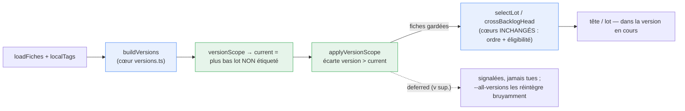

# ADR 0070 — Le tirage reste dans la version en cours (garde-fou de séquence)

**Statut :** Accepté (grooming, 2026-10-11)
**Date :** 2026-10-11
**Deciders :** PO (Thomas, décision du 2026-10-10) ; conception tranchée par `ezk-architect` au grooming
**Fiche :** [`20261010215345931`](../../../../features/20261010215345931_tirage-reste-dans-version-en-cours.md) (« Le tirage reste dans la version en cours »)
**Compose :** [`src/backlog/versions.ts`](../../src/backlog/versions.ts) (`buildVersions`, `releaseTagFor`) · s'appuie sur [ADR-0001](0001-monorepo-composable-coeur-deterministe.md) / [ADR-0003](0003-moteur-bind-plan-pur-coquille-io.md) (cœur pur déterministe, bords I/O) et l'axe unique `version:` ([ADR-0054](0054-cloture-sprint-vs-archive-session.md))

## En clair

Choisir la prochaine fiche (`next --ready-only`, `next --lot N`) suit l'ordre de `PLAN.md` et prend
la première fiche prête **sans regarder sa version**. Preuve du 2026-10-10 : un lot proposait des
fiches v0.8/v0.9 alors que la v0.7 n'était pas finie. On **discipline le tirage** : par défaut, il ne
voit que la **version en cours** — le plus bas lot pas encore étiqueté. La version suivante n'ouvre que
quand toutes les inférieures portent leur étiquette git `vX.Y` (pousser le tag = validation PO). Le
grooming reste libre. Une soupape bruyante `next --all-versions` lève le scope.

## Décision

1. **Réutiliser le calcul d'état des versions, ne rien réinventer.** `buildVersions(fiches, tags)`
   (cœur pur existant) range déjà chaque fiche dans son lot et marque chaque lot `livree`/`rouverte`
   dès que `releaseTagFor(version, tags)` trouve l'étiquette. « Taguée / entièrement livrée » est
   **déjà** là : on ne recode pas « version en cours ».

2. **Un seul garde-fou, dans un module pur dédié** — `src/backlog/version-scope.ts`, qui dépend
   **seulement** de `versions.ts` :
   ```ts
   export interface VersionScope {
     current?: string;                 // version en cours = plus bas lot sans releaseTag ; undefined si aucun lot
     inScope: ReadonlySet<string>;     // versions tirables : {current} par défaut, toutes si allVersions
     deferred: readonly string[];      // versions > current, écartées du tirage (pour le signal)
     empty: boolean;                   // current existe mais n'a aucune fiche todo → « complète, pousse le tag »
     allVersions: boolean;
   }
   export function versionScope(report: VersionsReport, opts?: { allVersions?: boolean }): VersionScope;

   // Appliqué aux fiches AVANT la sélection ; rend les gardées et les écartées (le message les montre).
   export function applyVersionScope<T extends { version: string }>(
     fiches: readonly T[], scope: VersionScope,
   ): { kept: T[]; deferred: T[] };
   ```
   Règle de scope : on **garde** la version en cours et les fiches **sans version** (`version: ''`, hors
   train, non régressives) ; on **écarte** toute fiche de version **strictement supérieure** à `current`.

3. **Filtrer au bord I/O, laisser les cœurs intacts (OCP/SRP).** Les cœurs `selectLot` (plan-lot) et
   `crossBacklogHead` (plan-head) gardent leur seule raison de changer : ordre + éligibilité. Les bords
   `bin/plan-lot.ts` et `bin/plan-head.ts` chaînent : `loadFiches` → `buildVersions(fiches, localTags)`
   → `applyVersionScope` → sélection existante. `next --ready-only` passe par `plan-head`, `next --lot`
   par `plan-lot` : **un seul** filtre sert les deux (DRY).

4. **Lecture des étiquettes déterministe et best-effort.** On extrait le lecteur local déjà éprouvé
   (`git tag -l` dans un `try/catch` → `Set` vide) de `bin/backlog-version.ts` vers
   `src/io/git-tags.ts`, réutilisé par les deux bords. Pas de dépôt / pas de git / pas de remote :
   zéro étiquette → aucune version n'est « livrée » → la v la plus basse est « en cours », le tirage
   **dégrade sans planter** (même doctrine que le reste de la méthode). Les étiquettes sont **locales**
   (git les partage entre worktrees), cohérentes avec `backlog version close --tag`.

5. **Deux fins de scope distinctes, aucun saut silencieux.** Version en cours sans fiche tirable mais
   avec des idées/bloquées → « aucune fiche tirable en v0.X, groome la tête ». Version `empty` (tout
   livré, pas encore taguée) → « v0.X est complète : pousse son étiquette (`backlog version close`)
   pour débloquer la suivante ». Jamais de bascule muette vers la version supérieure.

## Alternatives écartées

- **Dupliquer la détection de version dans chaque bin** — viole DRY et ADR-0001 ; trois endroits à
  garder d'accord.
- **Pousser le filtre dans les cœurs `selectLot`/`crossBacklogHead`** — leur ajoute une 2ᵉ raison de
  changer (SRP) et couple l'ordre du plan au train de versions. Le filtre est une étape **avant**.
- **Se fier à `PLAN.md` curé à jour** — c'est la cause du bug : le plan périme, la version des fiches
  non. Le garde-fou lit la version **réelle**.
- **Nouveaux flags `--version` / `--milestone`** — deux axes de séquence ; le PO en veut **un seul**.

## Conséquences

- `plan-lot`/`plan-head` gagnent une étape de filtre pure et testable ; message `--all-versions`
  (bruyant) en soupape. `bin/backlog-version.ts` perd son `localTags` local au profit du module partagé.
- La règle s'écrit dans le `SKILL.md` d'`ezk-backlog` (sections `next` / `--lot`).
- **À confirmer au PO** : fiches sans version gardées dans le scope (reco) ; étiquettes lues en
  **local** seulement (un tag poussé puis supprimé localement n'ouvre pas la suite).

## Schéma — le filtre de version, une étape avant les sélecteurs existants



*Lecture gauche→droite. **Bleu** = brique réutilisée telle quelle (calcul d'état des versions, sélecteurs d'ordre). **Vert** = l'ajout mince : un filtre pur qui écarte les fiches d'une version supérieure à la version en cours, posé AVANT la sélection. Les écartées sont signalées, jamais supprimées ; `--all-versions` les réintègre.*
